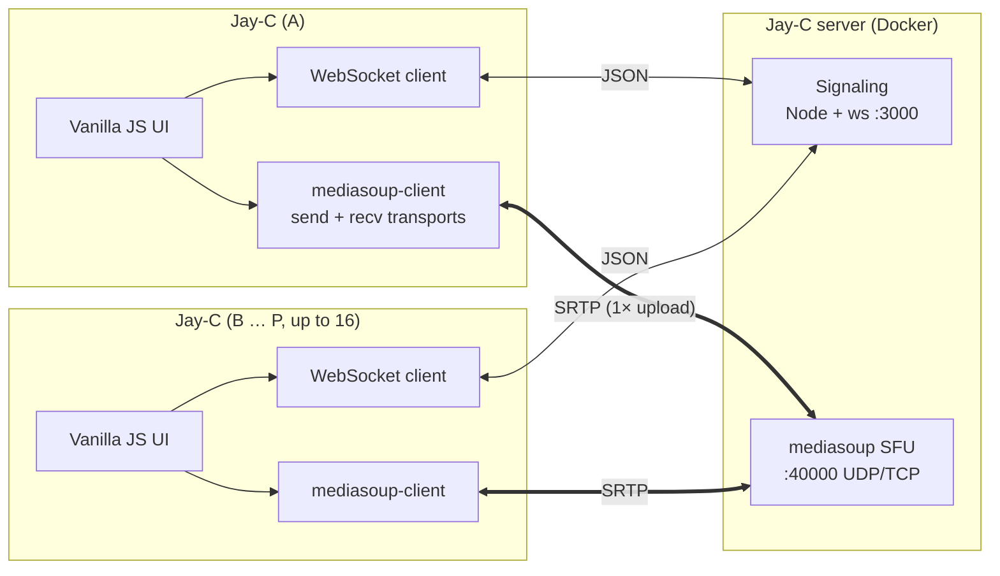
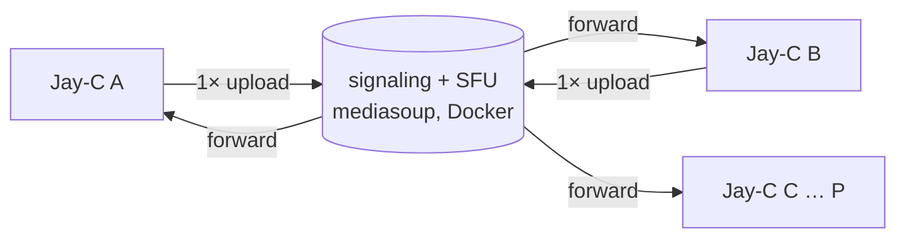

# Jay-C — Architecture

[Português](ARQUITETURA.md) · **English**

> Translation of [ARQUITETURA.md](ARQUITETURA.md). The Portuguese file is the reference and is updated first, so this one may lag behind it.

A lightweight, open-source app for calls and screen sharing on desktop and mobile, with a self-hosted signaling server that runs in Docker.

## 1. Overview



- The server does the **signaling** (port 3000) and **forwards the media** as an SFU (port 40000): it receives each track once and forwards it to whoever is watching, without decoding it.
- On a LAN, ZeroTier or Radmin VPN, the client reaches the server directly, with no STUN or TURN. For use over the internet without a VPN, the server hands clients the STUN/TURN servers set in `ICE_SERVERS`. An optional coturn service in the compose file is left for the release milestone.
- Rooms of **up to 16 people**. Up to milestone 6 the topology was mesh, with P2P between everyone and a limit of 4.

### Topology: SFU (up to 16 people)

In a mesh, each participant sends N−1 copies of every track. With 16 people, whoever shares their screen at 1080p60 (~6 Mbps) would need ~90 Mbps of upload. With an **SFU** (*Selective Forwarding Unit*), each person sends **once** to the server, which forwards it to the others without decoding.



| Topic | Choice | Why |
|---|---|---|
| SFU | **mediasoup** (Node.js + a C++ worker) in the **same container** as the signaling server | Reuses the Node server and our own protocol. Self-hosting is still a single `docker compose up -d`. |
| Ports | **One UDP/TCP port** for all media (mediasoup's `WebRtcServer`), plus 3000 for signaling | Easy to open in the firewall, to map in Docker Desktop and to explain in the guide |
| Announced IP | The server announces the IP/host the client used to connect (the WebSocket's `Host` header) | The user doesn't have to set the IP in the compose file. This had to be validated in the SFU milestone. |
| Cameras | **Simulcast** with 3 layers | The 16-person grid gets the low layer and whoever is featured gets the high one |
| Mesh | Removed in milestone 7. Every room goes through the SFU. | A single media path to maintain. On a LAN or VPN, the extra hop through the server is negligible. |

Cost for the host: the server receives each track once and resends it to each viewer. A 1080p60 screen for 15 people needs ~90 Mbps of **upload on the hosting machine**. On a LAN that's fine. Over the internet, through ZeroTier or Radmin, the host's connection becomes the limit, and the guide makes that clear.

## 2. Technical decisions

| Topic | Choice | Why |
|---|---|---|
| UI framework | **Vanilla JS + Vite** | No framework runtime, less memory and a smaller bundle. The UI is small: call, settings and modal. |
| Shell | **Tauri v2** | Uses the system WebView (WebView2, WKWebView, Android WebView) instead of bundling Chromium. |
| Server | **Node.js + `ws`** (not Socket.io) | The client uses the WebView's native `WebSocket`, with no extra library in the bundle. The protocol is plain JSON and the Docker image stays minimal (`node:alpine`). |
| Negotiation | The W3C **"perfect negotiation"** pattern | Resolves offer collisions (glare) and allows renegotiating by adding or removing tracks without dropping the call. |
| Quality changes | `track.applyConstraints()` + `RTCRtpSender.setParameters()` | Changes resolution, FPS and bitrate **without renegotiating SDP**. Switching the source (camera ↔ screen) uses `sender.replaceTrack()`, also without renegotiating. |
| Theme | CSS custom properties on `:root[data-theme]` | Switching is instant, it only changes an attribute. Follows `prefers-color-scheme` on first use. |
| Guide Markdown | Our own renderer (~80 lines) | The content is ours and controlled. It only needs headings, bold, `code`, images and paragraphs, with no extra dependency. Escapes HTML by default. |
| Guide assets | `frontend/public/assets/setup/`: 4 of our own SVG illustrations and 1 PNG screenshot of the app itself | Vite's `public/` folder is served at the root by Tauri. `src-tauri/icons/` is only for app icons. The illustrations are self-contained dark cards (the dark theme's palette), readable in both themes, with no logos or copies of third-party interfaces. They age better than screenshots of Docker or Windows. The screenshot (Settings › Server, 2×) is retaken over CDP when the screen changes. |
| Stream audio | **Native capture** (WASAPI process loopback) in a Tauri plugin | `getDisplayMedia` can't leave apps out of the system audio and doesn't capture window audio. Details in section 6. |
| Call microphone (Windows) | **Native capture** (WASAPI) + WebRTC's AudioProcessing (echo, noise, gain) in the plugin; `getUserMedia` on other platforms | The WebView2 microphone puts some laptops' audio into "call mode" and muffles the other apps. See [spikes/09](spikes/09-som-abafado.md) (in Portuguese). |
| Persistence | `localStorage` | Stores the server address, theme, quality preset and name. |

## 3. Monorepo layout

```
JayC/
├─ package.json                 # npm workspaces: frontend, signaling-server, plugin guest-js
├─ docs/ARQUITETURA.md
├─ signaling-server/
│  ├─ src/server.js             # HTTP (/health) + WebSocketServer
│  ├─ src/rooms.js              # rooms, peers, message routing
│  ├─ test/                     # node:test — join/leave/relay/limits
│  ├─ Dockerfile                # node:22-alpine, non-root user, HEALTHCHECK
│  ├─ docker-compose.yml        # port 3000; optional coturn ("turn" profile)
│  └─ .dockerignore
├─ frontend/
│  ├─ index.html
│  ├─ vite.config.js
│  ├─ public/assets/setup/step1_docker.svg … step4_address.svg, step5_connect.png
│  ├─ src/
│  │  ├─ main.js
│  │  ├─ styles/theme.css       # light/dark tokens
│  │  ├─ core/signaling.js      # WS client with reconnection + heartbeat
│  │  ├─ core/peer.js           # RTCPeerConnection + perfect negotiation
│  │  ├─ core/media.js          # getUserMedia / getDisplayMedia
│  │  ├─ core/quality.js        # presets → constraints + sender params
│  │  ├─ core/pip.js            # PiP abstraction per platform
│  │  ├─ core/activity-pip.js   # Android PiP (the whole activity floats)
│  │  ├─ core/platform.js       # detects desktop/android/ios via @tauri-apps/plugin-os
│  │  ├─ ui/call-view.js, ui/settings-modal.js, ui/setup-guide-modal.js
│  │  ├─ ui/markdown.js         # minimal renderer
│  │  ├─ content/setup-guide-connect.md, setup-guide-host.md # guide tabs, imported with ?raw
│  │  └─ store/settings.js
│  └─ src-tauri/
│     ├─ tauri.conf.json, Cargo.toml, capabilities/default.json
│     ├─ src/lib.rs, src/main.rs
│     └─ gen/android, gen/apple # generated by `tauri android|ios init`
├─ plugins/tauri-plugin-system-audio/   # per-process audio capture (Windows; macOS later)
│  ├─ src/lib.rs, src/commands.rs
│  ├─ src/windows/{loopback.rs, sessions.rs, mixer.rs}
│  └─ guest-js/index.js        # listAudioApps(), startCapture(), stopCapture()
└─ plugins/tauri-plugin-pip/   # Android activity PiP; the app calls `invoke('plugin:pip|…')` directly
   ├─ build.rs, src/lib.rs, permissions/default.toml
   └─ android/src/main/java/.../PipPlugin.kt   # (ios/ in milestone 15)
```

## 4. Signaling protocol (JSON over WebSocket)

Client → server:

| type | fields | |
|---|---|---|
| `join` | `room`, `name`, `avatar?`, `color?` | joins the room (creates it if it doesn't exist) |
| `profile` | `avatar` (data URL or `null`), `color` (`{from, to?, angle?}` or `null`) | changes the profile picture or color during the call; the others get `peer-updated`. The color only accepts `#rrggbb` and an integer angle 0–360 |
| `chat` | `text` (1–500 characters) | message to the room; the others get `chat`. Nothing is stored on the server |
| `screen-preview` | `image` (JPEG data URL, up to 48,000 characters, or `null` when stopping) | a picture of your own stream, every 6 s; the others get `screen-preview`, and whoever joins later gets the last one in `joined`. At most 1 every 2 s (burst of 3). Only sent when `joined` lists `screen-preview` in `features` |
| `leave` | — | leaves the room |
| *SFU request* | `id`, `data` | reply: `{type: "response", id, ok, data}` or `{…, ok: false, error}` |

SFU requests, named after the mediasoup API:

| type | `data` | reply |
|---|---|---|
| `createTransport` | `direction: "send" \| "recv"` | `id`, `iceParameters`, `iceCandidates` (with the address this client used), `dtlsParameters` |
| `closeTransport` | `transportId` (only your own) | — (closes its producers; their consumers get `producer-closed`). The native stream uses a transport of its own and closes it when it stops |
| `connectTransport` | `transportId`, `dtlsParameters` | — |
| `restartIce` | `transportId` | `iceParameters` |
| `produce` | `transportId`, `kind`, `rtpParameters`, `source` (`mic` \| `camera` \| `screen` \| `screen-audio`), `paused?` | `id` |
| `closeProducer` / `pauseProducer` / `resumeProducer` | `producerId` | — |
| `consume` | `producerId`, `rtpCapabilities` | `id`, `peerId`, `kind`, `source`, `rtpParameters`, `producerPaused` (the consumer starts paused) |
| `resumeConsumer` / `pauseConsumer` | `consumerId` | — (pausing = stop receiving, e.g. stopped watching a stream) |
| `setPreferredLayers` | `consumerId`, `spatialLayer`, `temporalLayer?` | — (only matters with simulcast) |

Server → client:

| type | fields | |
|---|---|---|
| `joined` | `id`, `room`, `peers: [{id, name, avatar?, color?, preview?, producers: [{id, kind, source, paused}]}]`, `iceServers`, `routerRtpCapabilities`, `features` | who is already in the room, what each one publishes and the router's capabilities. `features`: the newer messages the server accepts (today, `screen-preview`); an old server doesn't send the field |
| `peer-joined` / `peer-left` | `id`, `name`, `avatar?`, `color?` (only in `peer-joined`) | |
| `peer-updated` | `id`, `avatar`, `color` | someone changed or removed (`null`) their profile picture or color |
| `chat` | `id`, `name`, `text` | a message from someone in the room (line breaks kept; control characters removed) |
| `screen-preview` | `id`, `image` | a picture of someone's stream (`null` = stopped). The "Watch stream" card on their tile shows it |
| `new-producer` | `peerId`, `producerId`, `kind`, `source`, `paused` | someone started publishing a track |
| `producer-state` | `peerId`, `producerId`, `paused` | only for consumers: muted or turned the camera off, or back on |
| `producer-closed` | `peerId`, `producerId` | only for consumers |
| `error` | `code` (`room-full`, `bad-message`, `rate-limited`, `internal`), optional `ref` | |

Request errors: `not-in-room`, `bad-request`, `unknown-transport`, `unknown-producer`, `unknown-consumer`, `duplicate-source`, `cannot-consume`, `internal`.

Each person's "mic/camera on" state **is the pause state of their producers**. There is no separate message for it.

Configuration through environment variables:

| Variable | Default | What for |
|---|---|---|
| `PORT` | 3000 | signaling port |
| `HOST` | 0.0.0.0 | signaling interface |
| `MAX_PEERS_PER_ROOM` | 16 | maximum room size |
| `MAX_MESSAGE_BYTES` | 65536 | maximum message size |
| `HEARTBEAT_MS` | 30000 | ping/pong interval |
| `ALLOWED_ORIGINS` | empty = any | accepted origins |
| `ICE_SERVERS` | — | STUN/TURN, as JSON |
| `RTC_PORT` | 40000 | single media port, UDP and TCP |
| `RTC_LISTEN_IP` | 0.0.0.0 | media interface |
| `ANNOUNCED_ADDRESS` | empty = the host each client used | address announced in the ICE candidates |
| `MEDIASOUP_LOG_LEVEL` | warn | mediasoup log level |

Protections:
- Messages of at most 64 KB, at most 16 people per room and a messages-per-second limit (burst of 300, 100/s).
- Ping/pong every 30 s to drop dead connections.
- Peer IDs generated by the server, with `crypto.randomUUID()`.
- Profile picture (`avatar`): only `data:image/(webp|jpeg|png);base64,…` up to 32,000 characters. SVG is left out because it can carry script, and so are remote URLs, because they would track who sees them. An invalid picture rejects the `join` or `profile` with `bad-message`. The field is only sent when it exists.
- A `GET /health` endpoint for Docker's `HEALTHCHECK`.

## 5. Main flows

**Starting a call (SFU).**
1. The app connects to `ws://<ip>:3000`, sends `join` and receives `routerRtpCapabilities`, which loads the mediasoup-client `Device`.
2. It creates **two transports**: `send` (upload) and `recv` (download). Each is a single `RTCPeerConnection` with the server, on the media port.
3. It publishes `mic` and `camera` (*producers*) and consumes (*consumers*) every producer listed in `joined`. After that, also every `new-producer` that arrives.

Consumers start paused and the client resumes them when it's ready, so the first keyframe isn't lost.

**Camera with simulcast.** There are 3 layers (÷4, ÷2 and full), at 150, 500 and 1500 kbps. The client asks the SFU for the layer that fits the tile size: with up to 2 cameras on screen they get the high layer, up to 6 the middle one, and above that the low one. Chrome only produces the layers the input resolution allows; with 720p cameras all 3 come out.

**Media state.** Muting or turning the camera off is `producer.pause()` on the client plus `pauseProducer` on the server. Consumers get `producer-state` right away and show the avatar or the mute icon. Turning the camera off also does `replaceTrack(null)` and stops the track, so the camera light goes off.

**Server outage.** Since media goes through the SFU, **the call stops while the server is down**, and a notice shows on screen. The client reconnects with backoff (1, 2, 4, 8 and 10 s), gets a new id and rebuilds transports, producers and consumers from the new `joined`. In testing, with the server restarted, it came back in ~1 s.

## 6. Streams ("lives")

When starting a stream, the person picks one of two modes:

| Mode | Video | Audio sent |
|---|---|---|
| **Entire screen** | a monitor, via `getDisplayMedia` | all system audio **except** Jay-C itself (the call's voices) and the apps on the exclusion list in Settings › Streaming (e.g. Discord) |
| **Window** | an app's window, via `getDisplayMedia` | **only** the audio of the process that owns that window, including its child processes |

### Why the audio is native

`getDisplayMedia`'s audio doesn't work for these two modes:
- **Entire screen:** on Windows it captures the whole system mix. That includes the call's voices, which causes echo, and Discord. There's no way to filter by app.
- **Window:** Chromium doesn't capture window audio, only browser-tab audio.

So the video still comes from `getDisplayMedia` and the **audio is captured in Rust**.

### Audio pipeline (Windows)

```
WASAPI process loopback        Rust mixer                 tauri::ipc::Channel      AudioWorklet
(1 stream per process)   ──►  48 kHz stereo f32,  ──►   (bytes, ~100 msg/s)  ──►  (ring buffer) ──► MediaStreamAudioDestinationNode
                              10 ms blocks                                                               │
                                                                                                         ▼
                                                                                   "screen-audio" track → its own transceiver
```

- **Windows API:** `ActivateAudioInterfaceAsync` with `AUDIOCLIENT_PROCESS_LOOPBACK_PARAMS`, available from Windows 10 2004 (build 19041). Each stream **includes or excludes a single process tree**.
- **Entire screen:**
  - If the exclusion list is empty, one EXCLUDE stream of the tree of the **WebView2 browser process** is enough: the `msedgewebview2.exe` that is a direct child of Jay-C, which plays all of the app's sound. The tree of `jay-c.exe` itself doesn't work: for Windows' loopback, it doesn't include WebView2. See [spikes/06](spikes/06-transmissoes.md) (in Portuguese).
  - With exclusions: the app lists the active audio sessions (`IAudioSessionManager2`) and opens one INCLUDE stream per process that isn't Jay-C and isn't on the list. The comparison is by executable name, including ancestor processes. A root already inside another root's tree is skipped, so the sound isn't mixed in twice. Since INCLUDE takes the **whole tree**, no root may have Jay-C or an excluded app in its tree: all their ancestors are off-limits. That way `explorer.exe` with an audio session is never captured, because its tree contains almost everything, including the call's voices. When the parent of an excluded app plays sound, that parent is also left out, and privacy wins. This was found in the real app: with the players as children of the same terminal, the excluded app leaked through the terminal's tree. The `exclusion_live_nested` test covers that case. The streams are mixed by a thread with its own 20 ms clock. It doesn't depend on any stream, because a silent process may not deliver packets and an app can close. Each stream only enters the mix after it has 40 ms queued, so packet jitter doesn't cut the sound. A stream that fails to open is skipped. Measured with tones from two executables: the excluded app drops from −16.7 to −90 dB and the other stays at −16.7 dB (`exclusion_live` test, `cargo test --lib -- --ignored`).
  - During the stream, the sessions are re-evaluated every 2 s. A new app gets a stream, and the stream of an app that closed (or lost its session) leaves the mix. A scan was used instead of `IAudioSessionNotification`: it's simpler and also notices when an app closes. An app that joins may lose up to ~2 s of its start. One app's errors only go to the log, because an app closing must not take down the stream's sound. Measured (`exclusion_live`): with the captures started before the players, both tones enter the mix (−16.5 dB). When a player closes, the number of streams goes back to what it was and the mixer keeps running at 48 kHz.
  - **CPU** (`cpu_many_streams`, release, Ryzen 5 5600G with 12 threads, over 10 s): the single stream uses 1–3% of a core. Per-app mode uses ~5% with 5 streams and 7–15% with 15, that is, ~1% of a core per stream and at most ~1.2% of the whole CPU. Two measurements of the single stream gave 46,242 and 47,530 frames/s instead of 48,000, right after starting 10 PowerShells. The next three runs (0, 1 and 10 players) gave 47,963–48,009. It wasn't reproduced, and the cause (load at the start of the measurement?) wasn't confirmed.
- **Window:** gets the process that owns the window with HWND → `GetWindowThreadProcessId` and opens an INCLUDE stream of that tree.
- **Plugin:** `plugins/tauri-plugin-system-audio`, in Rust with the `windows` crate. Commands:
  - `list_audio_apps()`: apps playing sound right now, for the Settings screen
  - `start_capture({ include[] | excludeSelf, excludeExes[] }, channel)`
  - `stop_capture()`

  On other platforms the plugin answers `unsupported` and the stream goes out without audio. On macOS, ScreenCaptureKit (`SCContentFilter` with `excludingApplications`) covers both modes and is left for a later phase.
- **Finding out which window was picked:**
  - The label of the `getDisplayMedia` video track in Chromium identifies the source, as `window:<HWND>:0`. This still **had to be validated in WebView2** (spike).
  - Plan B: our own window picker in Rust, with `EnumWindows` and thumbnails.

### Media and signaling

- Each participant publishes up to **4 tracks**: microphone, camera, screen video and screen audio. On the SFU, each one is a mediasoup *producer*. Starting or stopping a stream is just `replaceTrack()`, with no renegotiation, and you can share your screen with the camera on.
- The stream's state comes from the producers themselves. A `screen` producer, and `screen-audio` if there is audio, exists while the person streams. The mode (screen or window) goes in the producer's `appData` and reaches the others in `new-producer`. Viewers show the screen featured, with the cameras as thumbnails.
- Screen audio uses **stereo** Opus at ~128 kbps. Chrome sends mono by default, so `stereo=1; sprop-stereo=1` has to be added to Opus's fmtp in the SDP.
- `track.contentHint`: `detail` for text and code, `motion` for games and video.

### Quality during the stream

Everything is in the call's "Share" panel, which is a `popover`. The choices are saved for next time.

1. `track.applyConstraints({ frameRate: {max}, height: {max} })` shrinks the capture at the source, which is the cheapest path. Chromium does this with `resizeMode: crop-and-scale`.
2. `producer.setRtpEncodingParameters({ maxBitrate, maxFramerate, scaleResolutionDownBy })` tunes the encoder. If the capture is still bigger than requested, because `applyConstraints` was ignored, the encoder does the scaling (`scaleResolutionDownBy`).
3. There's no renegotiation and no drop: the SSRC is the same before and after, checked with `getStats()`.

| Option | Values |
|---|---|
| Resolution | 360p, 480p, 720p, 1080p (default), 1440p or Source |
| FPS | 5, 15, 24, 30 (default) or 60 |
| Optimize for | *Text & detail* (`contentHint: detail`, default) or *Motion & games* (`motion`) |

Automatic bitrate: ~0.08 bit/pixel/frame, with frames above 30 fps counting half. That gives ≈5 Mbps at 1080p30 and ≈7.5 Mbps at 1080p60, between 0.2 and 12 Mbps.

The screen goes as a single layer, without simulcast, in **H.264 High** (`profile-level-id` 640032, added to the router). With this profile WebView2 uses the graphics card's encoder (Media Foundation: `NVIDIA H.264 Encoder MFT`, measured on an RTX 3050). Constrained-baseline H.264 (42e01f) stays on OpenH264 in software, even at 720p, and VP8 stays on libvpx. An old server, without the High profile: VP8. During an **entire screen** stream **through the system picker** (the path without the native stream), Jay-C's window leaves the capture (`setContentProtected` = `WDA_EXCLUDEFROMCAPTURE`), so it doesn't film its own preview (mirror effect). The native stream has no local video, so Jay-C shows up in it, and Jay-C's own window can be streamed (without its sound, which would be the call's).

**For viewers:** the layout switches to *presenting*, with the screens featured and the cameras in a 160 px strip (asking for the lowest layer). Double-clicking the screen opens it full screen. The streamer sees a small preview in a corner.

### Settings › Streaming

- **Exclusion list** of apps by executable name (`excludedApps`), saved in the settings. Suggestions as chips: the apps with an audio session right now (`list_audio_apps`, refreshed when Settings opens) plus Discord, Teams (`ms-teams.exe`) and Zoom. The name can also be typed, with ".exe" optional and case-insensitive.
- The section only shows where native capture exists (Windows).
- **Applied live:** changing the list during an entire screen stream restarts the capture and swaps the track with `replaceTrack`, without renegotiating. Restarts run one at a time, because each one replaces the previous Rust capture.
- Jay-C is never streamed and doesn't appear in the list.

## 7. Picture-in-picture

`core/pip.js` provides the API (`createPip`, `pickPipTrack`, `pipSupported`) and picks the implementation:

| Platform | Implementation |
|---|---|
| Windows (WebView2/Chromium) ✅ | `video.requestPictureInPicture()` on a `<video>` outside the DOM. The window stays on top (`WS_EX_TOPMOST`, measured). The microphone, camera and hang-up buttons come from the Media Session API (`togglemicrophone`, `togglecamera`, `hangup`). **Document PiP doesn't work**: the API exists in WebView2, but `requestWindow` fails with "Internal error: no window" (3 out of 3 attempts). |
| macOS (WKWebView) | `video.requestPictureInPicture()` (Safari 13.1+) |
| Linux (WebKitGTK) / general fallback | **Tauri mini-window**: a small `WebviewWindow` with `alwaysOnTop: true`, undecorated, showing the remote stream |
| Android ✅ | Kotlin plugin `tauri-plugin-pip`: the **whole activity** floats, because the Android WebView has no `<video>` PiP. `setAutoEnterEnabled(true)` (API 31+) or the user-leave hint (API 26–30) enter PiP when leaving the app during a call; the "Pop out video" button calls `enter`. Manifest: `android:supportsPictureInPicture="true"` and `resizeableActivity`. |
| iOS | Swift plugin: `AVPictureInPictureController` with `AVPictureInPictureVideoCallViewController` (iOS 15+), `canStartPictureInPictureAutomaticallyFromInline = true` and the `audio` + `voip` background modes. A simpler alternative to evaluate: WKWebView's own `video.webkitSetPresentationMode('picture-in-picture')`. |

**Desktop:**
- **Opening and the video shown:** the "Pop out video" button is in the call controls. The PiP shows someone's shared screen; if there is none, it shows the first camera that's on.
- **Switching the video:** since the same `<video>` stays in the PiP, the track switches without another click when someone starts or stops streaming, turns their camera off or leaves. The PiP closes when no video is left and when the call ends.
- **Sound:** comes from the call's tiles; the PiP video is muted.
- **No automatic entry:** the PiP doesn't open by itself on minimize, because the request needs a user click.
- **Remote tracks:** arrive `muted` and only unmute with the first frames, with no participant event. So the button also listens to the tracks' `mute`/`unmute`/`ended`.

**Android** (`core/activity-pip.js` + `plugins/tauri-plugin-pip`):
- **Entry:** during a call, the page turns automatic entry on with the featured video's aspect ratio (Android limits it to between 1:2.39 and 2.39:1). Leaving the app (Home, recents) or the button shrink the activity.
- **Compact layout:** the plugin sends the `pipModeChanged` event. The page sets `html[data-activity-pip]` and the CSS shows only a full-screen `<video>` with the featured track, which switches as on desktop.
- **Paused WebView:** Android pauses the activity in PiP, and `WryActivity.onPause` pauses the WebView with it. The mini-window froze on the last frame (the top of the interface), and the page became `hidden`. So the plugin calls `webView.onResume()` while in PiP. The plugins' `onPause` runs after WryActivity's. If the PiP closes without going back to the app, the plugin pauses the WebView again.
- **Measured on the emulator (Android 16, API 36):**
  - Through Home, the event reaches the page ~4.5 s later. That's the system animation's duration (`sendOnPipTransitionFinished` in the logs); the app adds ~0.2 s. The first entry after installing took 17 s and didn't happen again.
  - Through the button, the PiP opens in 4.5 s.
  - In PiP, the page stays visible at 228×128 and the video runs at 10–16 fps.
  - When expanding, the layout comes back in ~2 s and the call continues.
  - Not tested on a real phone or on Android 8–11.

## 8. Known risks (important)

1. **Screen sharing on mobile doesn't work through `getDisplayMedia`.** The Android WebView and iOS WKWebView don't implement that API.
   - Android requires native capture with `MediaProjection` + a foreground service, and the video has to go back into WebRTC. That's complex.
   - iOS requires a *Broadcast Upload Extension* (ReplayKit).
   - Proposal: **on mobile, v1 only receives screens and does camera and audio calls**. Sharing the screen from a phone is left for a later phase.
2. **iOS only builds on a Mac with Xcode.** On this Windows PC the Swift code can be written, but not built or tested.
3. **Linux/WebKitGTK** has partial `getDisplayMedia` and WebRTC support, depending on the version. The main target is Windows, then macOS.
4. **Android permissions**: camera and microphone have to be declared in the manifest and granted at runtime. The WebView also has to accept `onPermissionRequest`. Validated in milestone 13: wry already asks for CAMERA and RECORD_AUDIO in `onPermissionRequest`, so declaring them in the manifest is enough.
5. **Setup guide**:
   - For `docker compose up -d` to "download the server automatically", the image has to be **published in a registry** (GHCR or Docker Hub). That requires a public GitHub repository.
   - The current command is `docker compose` (with a space). `docker-compose` is v1, discontinued. The guide's text will be adjusted.
6. **Windows Firewall** on the host has to open port 3000. Worth mentioning in the guide.
7. ~~**Streams: points to validate in the spike (milestone 6)**~~ ✅ Validated, see [spikes/06-transmissoes.md](spikes/06-transmissoes.md) (in Portuguese). `getDisplayMedia` works in WebView2 and the `window:<HWND>:0` label identifies the window, so Plan B isn't needed. Process loopback works in INCLUDE and EXCLUDE modes, with several simultaneous streams.
8. **Process loopback** only exists from Windows 10 2004. On earlier versions, the stream goes out without audio, with a notice.
9. **Apps whose audio comes from another process** outside the window's tree, such as some games and launchers. In those cases window mode captures silence, and entire screen mode still works.
10. **Screen audio/video sync:** the native audio and the video take different paths into WebRTC. The difference needs measuring; ~50–100 ms is acceptable for a stream.
11. **SFU with 16 people:**
    - The host's upload bandwidth becomes the limit (see section 1).
    - The Docker image grows because of the mediasoup worker.
    - ✅ Validated in milestone 7: UDP mapping in Docker Desktop on Windows and the IP announced from `Host`, both on `localhost` and on the LAN IP.
    - The VPN IP (ZeroTier/Radmin) is still untested.
    - The image is now 379 MB, because of the Debian base needed by mediasoup's prebuilt worker.

## 9. Required tools

| Tool | What for | Status on this machine |
|---|---|---|
| Node.js + npm | frontend, server, Tauri CLI | ✅ v24.21 / 11.19 |
| Git | version control | ✅ |
| WebView2 | Tauri's runtime on Windows | ✅ 156 |
| WSL2 | Docker Desktop backend | ✅ (Ubuntu) |
| MS C++ Build Tools (VS 2022, "Desktop development with C++") | Rust's linker on Windows and the Windows SDK (WASAPI) | ✅ |
| Rust (rustup, MSVC toolchain) | building Tauri and the plugins | ✅ 1.99 |
| Docker Desktop | testing the server image | ✅ 29.9 |
| Android Studio (JDK) + SDK 36/37, NDK 30, emulator | Android build | ✅ |
| Rust Android targets (`aarch64-linux-android` etc.) | Android build | ✅ |
| Python 3.13 + Meson + Ninja (`pip install --user meson ninja`) | building WebRTC's audio processing on Windows | ✅ |
| Xcode | iOS build | ⛔ impossible on Windows |

The Tauri CLI comes in as a `devDependency` (`@tauri-apps/cli`), with no global install.

## 10. Implementation milestones

Each milestone ends with something testable.

| # | Milestone | Done when |
|---|---|---|
| 0 ✅ | Install tools | `rustc`, `cargo`, `docker` and `java` respond. `npx tauri info` with no errors. |
| 1 ✅ | Monorepo scaffold + `git init` | `npm install` at the root works |
| 2 ✅ | Signaling server + tests | `npm test` passes and two clients exchange messages |
| 3 ✅ | Server Docker | `docker compose up -d` starts and `/health` returns 200 |
| 4 ✅ | Base frontend: Vite + Tauri desktop, theme, settings | `npm run tauri dev` opens the window and the theme switches instantly |
| 5 ✅ | Calls (camera/mic), 1:1 and up to 4 people | two app instances see and hear each other through the local server |
| 6 ✅ | **Streams spike** (Windows), see [spikes/06-transmissoes.md](spikes/06-transmissoes.md) (in Portuguese) | In Tauri: `getDisplayMedia` opens the picker and the picked window can be found (or Plan B was decided). A Rust prototype captures the audio of a single process. |
| 7 ✅ | **SFU (mediasoup)** in the container, transport interface on the client, state through signaling, simulcast; the room limit goes to 16 | 16 tabs or instances in a room see each other; each client sends 1× (confirmed in `getStats()`); Docker only exposes 3000 and one media port |
| 8 ✅ | **Stream: video** (entire screen and window), the screen featured for viewers and quality controls | resolution and FPS change during the stream without the call dropping, confirmed in `getStats()` |
| 9 ✅ | **`system-audio` plugin (Windows):** process loopback, mixer, Channel → AudioWorklet → WebRTC track bridge, stereo Opus | viewers hear the audio of a chosen app, in stereo |
| 10 ✅ | **Full modes + Settings › Streaming** | Entire screen: with Discord excluded, nobody hears Discord or the call's voices. Window: only that app's audio is sent. |
| 11 ✅ | Desktop PiP | the remote video floats over other windows |
| 12 ✅ | Guide modal + Markdown renderer + images (with the media port and the bandwidth note) | the guide renders with the 5 images in both themes |
| 13 ✅ | Android: `tauri android init`, permissions, Kotlin PiP plugin | the APK runs on the emulator or a phone, joins a call and goes into PiP when minimized |
| 14 | Release: image on GHCR + Windows installer (`.exe`) + `.apk` | the 5-step guide works from scratch on a clean machine |
| 15 | iOS: Swift plugin (code), postponed until after launch | code written; build pending a Mac |

### Release (milestone 14)

| Part | Deliverable | Status |
|---|---|---|
| 14.A | **Windows installer** (NSIS, `.exe`) built locally | ✅ |
| 14.B | Signed **release APK** (ARM 64 and 32-bit) | |
| 14.C | **GitHub Actions:** on a `v*` tag, builds the `.exe`, the `.apk` and the GHCR image, and drafts a Release with the `docker-compose.yml` | |
| 14.D | The user's **icon** in every size (`tauri icon`): the Jay-C wolf, with thickened lines and a filled head (`scripts/wolf-icon.ps1`), in each style's color | ✅ |
| 14.E | **Publishing** and testing the guide from scratch on a clean machine | |

**Windows installer** (`npm run build`, ~7–9 min with LTO):
- **Type:** per-user NSIS (`installMode: currentUser`). Installs to `%LOCALAPPDATA%\Jay-C` without UAC, with a Start menu shortcut and an entry in "Apps" (publisher TyxMatty). WebView2 comes through the bootstrapper if missing (old Windows 10).
- **Size:** a 1.47 MiB installer and a 3.9 MB `jay-c.exe`.
- **No code signing:** SmartScreen warns on first run. A certificate costs money (open decision).
- **Reinstalling over it** updates the exe. The installer only closes a `jay-c.exe` that runs from the install folder (Restart Manager on the exact path), not the one from `tauri dev`.
- **Camera and microphone without WebView2's prompt:** on a new profile, WebView2 asked "tauri.localhost wants to use your camera", and joining the room hung on "Joining…" until it was answered. Now `src-tauri/src/media_permissions.rs` allows camera and microphone in the `PermissionRequested` event, only for the app's own page (`http://tauri.localhost/`, and `localhost:5173` in dev). Other permissions keep WebView2's default. Windows' privacy settings still apply.

**Checked in the installed app** (isolated WebView2 profile, test server, a bot in the room):
- Release mode: the page comes from `http://tauri.localhost/`, and `window.__jaycCall` doesn't exist.
- **Joining the room:** through the lobby, with no permission prompt and no CSP violations.
- **Camera:** reaches the bot at 1280×720.
- **Native microphone:** WASAPI → AudioWorklet → track → WebRTC. Measured on the sending side (`media-source`: level varying, energy rising), and real audio reaches the bot (peak −50.9 dBFS in a quiet room, with noise suppression).
- **Entire screen with sound:** with the picker replaced by a canvas, a test tone played in another process reaches the bot in stereo at −37 dBFS (L 445 Hz, R 656 Hz; the tone was 440/660 Hz).
- **Not tested:** the real screen picker and SmartScreen on a machine without the project.

### "Welcome!" tour (user request, after 0.2.1)

Cards that explain the app step by step, for first-time users.

| Part | Deliverable | Status |
|---|---|---|
| W1 | **Structure:** a modal with 7 cards (welcome, server, profile, room, call, stream, chat/PiP/help), Back/Next, clickable dots, arrow keys, Skip. Opens by itself the first time; Settings › Help › "Show the welcome tour" reopens it. | ✅ |
| W2 | **Animations:** an animated SVG/CSS illustration per card (`ui/welcome-art.js`), transitions between cards and a stable height. | ✅ |

**How it works:**
- **Files:** content and navigation in `core/welcome.js` (`WELCOME_STEPS`, `clampStep`, `shouldShowWelcome`, with tests), the modal in `ui/welcome-modal.js` and the `.welcome-*` CSS.
- **"Already seen":** `settings.welcomeSeen` is saved **when the tour opens by itself**, not when it closes. That way it shows once even if the app is closed halfway through, and it doesn't depend on the `<dialog>`'s `close` event, which Chrome only fires on the next painted frame (in a hidden panel it never arrived). People who already used the app see the tour once after updating.
- **Shortcuts:** the server card opens the setup guide and the profile card opens Settings › Profile, on top of the tour, which stays open underneath.
- **Illustrations (W2):** one SVG scene per step in `ui/welcome-art.js`, in the theme's colors (the highlight is `currentColor`; the `.wa-*` classes use the theme variables). The animations (`@keyframes wa-*`) only run with `<html data-motion="full">`; without it, each scene is a still picture. Changing step makes the card slide in from the side it came from (Web Animations, 220 ms). The height is that of the longest step: `fitHeight()` measures the 7 texts on open and on resize (it depends on the width and the language), and the shortcut button takes its space even when hidden. Measured in the app at 1100 px: a 553 px card and the title in the same position on all 7 steps; 4 to 7 animations per scene; none with animations off, in the dark and light themes.
- **Accessibility:** the step text is in an `aria-live` region, and the current dot has `aria-current="step"`. Focus goes to Next on open. Esc closes it. There's no X button: the X sat on top of the illustration, and Skip, Get started and Esc already close it.

**Checked in the browser** (Claude's panel, the dev Vite server):
- first open with no saved settings;
- the 7 steps through the arrows and the dots (Back off on the first; on the last, "Get started" and no Skip);
- both shortcuts;
- reload without reopening;
- reopening through Help;
- at 360×640, every card fits without scrolling;
- light theme.

### Customization (between 12 and 13, at the user's request)

Plugins were left for after the release. Plugins without isolation on the client are ruled out: they would reach Tauri's IPC (audio, screen and microphone capture). Customization comes in three parts:

| Part | Deliverable | Status |
|---|---|---|
| 12.A | **Settings › Appearance:** button color and a gradient app background (2 colors + angle) | ✅ |
| 12.B | **Call bar:** drag with the mouse to reorder the buttons and to move the bar to one of the 4 edges, with a keyboard alternative in Settings | ✅ |
| 12.C | **Profile picture:** cropped to a square and shrunk (~128 px). Goes through the server with the name, with size and type validation, and shows when the camera is off. | ✅ |

**How appearance works** (`core/appearance.js`, applied in `ui/theme.js`):
- **Inline variables on `<html>`**, valid in both themes: `--accent`, `--accent-hover`, `--accent-contrast`, `--accent-text` and `--app-background`. Empty values fall back to the theme's tokens.
- **Button text:** white or near-black, whichever contrasts more with the chosen color (WCAG). Hover lightens dark buttons and darkens light ones.
- **`--accent-text`:** where the accent color becomes text over the theme's surfaces (the brand's hyphen and the tile initials), it's mixed at 35% with the theme's text color. Measured in the app: ≥ 5.4:1 in both themes, even with pure white or black. With 55%, yellow on the light theme gave 4.07.
- **Gradient:** only on the `body` (`--app-background`). The panels keep the theme's surfaces, so text never sits on the gradient. `theme-init.js` applies the gradient before the first paint, so it doesn't flash.
- **Top bar with a gradient:** becomes translucent (75% of the theme's surface, with blur) and gets no setting of its own. In the worst case calculated (a white gradient on the dark theme), the brand sits at 6.38:1. The status pill and the buttons have an opaque background. Windows' native title bar keeps the theme color.

**How the bar works** (`ui/control-bar.js`, pure logic in `core/call-bar.js`, saved in `settings.callBar`):
- **Layout:** `section.call` has two parts, `.call-main` (notice, stage, "waiting", toast) and the bar. The flex direction follows `data-bar` (`column`, `column-reverse`, `row-reverse`, `row`). The share panel opens next to the bar.
- **Dragging:** pointer events, so it works with mouse, pen and touch. A drag only starts after 6 px; below that it's a click.
  - `pointermove`/`pointerup` live on `window` while the button is held, because a fast drag leaves the bar before the threshold. That bug was found while testing.
  - Pointer capture stays on the bar, not the button: moving the button in the DOM would release the capture.
  - The click that follows a drag is suppressed, so the share panel doesn't open by itself.
- **Handle (⋮⋮):** dragging shows where the bar will land (the nearest edge). Clicking, including from the keyboard, moves the bar to the next edge.
- **Settings › Call controls:** position and order with the ↑/↓ arrows. Focus stays on the button that moved.
- Checked with real mouse events over CDP (`Input.dispatchMouseEvent`): reordering on both axes, a normal click still toggling the mic, the handle on the left and top edges, and the click on the handle.

**Profile picture** (`core/avatar.js`, Settings › General):
- **Crop and format:** the chosen image is cropped to the central square and shrunk to 128 px as WebP, lowering the quality if it goes over 32,000 characters. On WebKit, which can't encode WebP, it becomes JPEG. Measured: a 1600×900 photo came out at 1,783 characters.
- **In the call:** the picture shows instead of the initials when the camera is off. A change during the call reaches the others through `profile`/`peer-updated`. On a reconnect, `join` carries the current picture.
