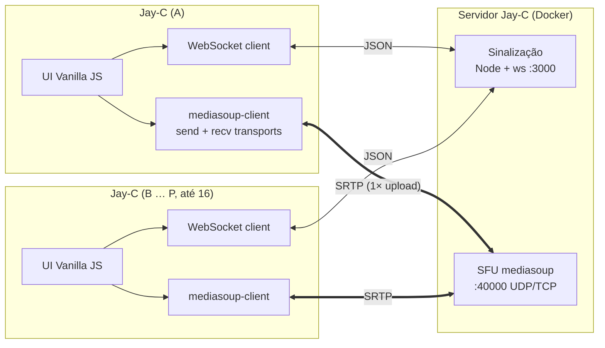
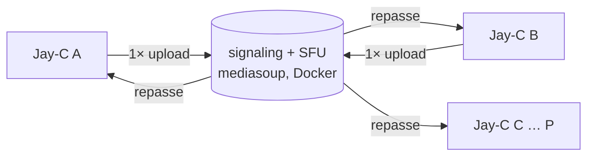

# Jay-C — Arquitetura

**Português** · [English](ARQUITETURA.en.md)

App leve e open-source de chamadas e compartilhamento de tela, para desktop e mobile, com servidor de sinalização self-hosted via Docker.

## 1. Visão geral



- O servidor faz a **sinalização** (porta 3000) e **repassa a mídia** como SFU (porta 40000): recebe cada faixa uma vez e a encaminha a quem assiste, sem decodificar.
- Em LAN, ZeroTier ou Radmin VPN, o cliente alcança o servidor direto, sem STUN ou TURN. Para uso pela internet sem VPN, o servidor repassa aos clientes os STUN/TURN definidos em `ICE_SERVERS`. Um serviço coturn opcional no compose fica para a etapa de release.
- Salas de **até 16 pessoas**. Até a etapa 6 a topologia era mesh, com P2P entre todos e limite de 4.

### Topologia: SFU (até 16 pessoas)

Em mesh, cada participante envia N−1 cópias de cada faixa. Com 16 pessoas, quem transmite a tela em 1080p60 (~6 Mbps) precisaria de ~90 Mbps de upload. Com um **SFU** (*Selective Forwarding Unit*), cada pessoa envia **uma vez** para o servidor, que repassa para as outras sem decodificar.



| Tema | Escolha | Motivo |
|---|---|---|
| SFU | **mediasoup** (Node.js + worker em C++) no **mesmo container** do servidor de sinalização | Reaproveita o servidor Node e o protocolo próprio. O self-hosting continua sendo um único `docker compose up -d`. |
| Portas | **Uma porta UDP/TCP** para toda a mídia (`WebRtcServer` do mediasoup), além da 3000 da sinalização | É fácil de liberar no firewall, de mapear no Docker Desktop e de explicar no guia |
| IP anunciado | O servidor anuncia o IP/host que o cliente usou para conectar (cabeçalho `Host` do WebSocket) | O usuário não precisa configurar o IP no compose. Isso precisa ser validado na etapa do SFU. |
| Câmeras | **Simulcast** em 3 camadas | A grade de 16 recebe a camada baixa e quem está em destaque recebe a alta |
| Mesh | Removido na etapa 7. Todas as salas passam pelo SFU. | Um só caminho de mídia para manter. Na LAN ou VPN, o salto extra pelo servidor é desprezível. |

Custo para quem hospeda: o servidor recebe cada faixa uma vez e reenvia para cada espectador. Uma tela em 1080p60 para 15 pessoas pede ~90 Mbps de **upload da máquina que hospeda**. Na LAN isso é tranquilo. Pela internet, via ZeroTier ou Radmin, o limite passa a ser a conexão do host, e o guia vai deixar isso claro.

## 2. Decisões técnicas

| Tema | Escolha | Motivo |
|---|---|---|
| Framework UI | **Vanilla JS + Vite** | Zero runtime de framework, menor memória e bundle. A UI é pequena: chamada, configurações e modal. |
| Shell | **Tauri v2** | Usa a WebView do sistema (WebView2, WKWebView, Android WebView) em vez de embutir o Chromium. |
| Servidor | **Node.js + `ws`** (não Socket.io) | O cliente usa o `WebSocket` nativo da WebView, sem lib extra no bundle. O protocolo é JSON simples e a imagem Docker fica mínima (`node:alpine`). |
| Negociação | Padrão **"perfect negotiation"** (W3C) | Resolve colisões de oferta (glare) e permite renegociar adicionando ou removendo faixas sem derrubar a chamada. |
| Troca de qualidade | `track.applyConstraints()` + `RTCRtpSender.setParameters()` | Muda resolução, FPS e bitrate **sem renegociar SDP**. Para trocar a fonte (câmera ↔ tela) usa `sender.replaceTrack()`, também sem renegociar. |
| Tema | CSS Custom Properties em `:root[data-theme]` | A troca é instantânea, só muda um atributo. Respeita `prefers-color-scheme` no primeiro uso. |
| Markdown do guia | Renderer próprio (~80 linhas) | O conteúdo é nosso e controlado. Basta suportar títulos, negrito, `code`, imagens e parágrafos, sem dependência extra. Escapa HTML por padrão. |
| Assets do guia | `frontend/public/assets/setup/`: 4 ilustrações SVG próprias e 1 captura PNG do próprio app | A pasta `public/` do Vite é servida na raiz pelo Tauri. `src-tauri/icons/` é só para ícones do app. As ilustrações são cartões escuros autocontidos (paleta do tema escuro), legíveis nos dois temas, sem logos nem cópias da interface de terceiros. Elas envelhecem menos que screenshots do Docker ou do Windows. A captura (Settings › Server, 2×) é refeita pelo CDP quando a tela mudar. |
| Áudio das transmissões | **Captura nativa** (WASAPI process loopback) num plugin Tauri | O `getDisplayMedia` não exclui apps do áudio do sistema nem captura áudio de janela. Detalhes na seção 6. |
| Microfone das chamadas (Windows) | **Captura nativa** (WASAPI) + AudioProcessing do WebRTC (eco, ruído, ganho) no plugin; `getUserMedia` nas outras plataformas | O microfone do WebView2 coloca o áudio de alguns notebooks em "modo chamada" e abafa os outros apps. Ver [spikes/09](spikes/09-som-abafado.md). |
| Persistência | `localStorage` | Guarda endereço do servidor, tema, preset de qualidade e nome. |

## 3. Estrutura do monorepo

```
JayC/
├─ package.json                 # npm workspaces: frontend, signaling-server, plugin guest-js
├─ docs/ARQUITETURA.md
├─ signaling-server/
│  ├─ src/server.js             # HTTP (/health) + WebSocketServer
│  ├─ src/rooms.js              # salas, peers, roteamento de mensagens
│  ├─ test/                     # node:test — join/leave/relay/limites
│  ├─ Dockerfile                # node:22-alpine, usuário não-root, HEALTHCHECK
│  ├─ docker-compose.yml        # porta 3000; coturn opcional (profile "turn")
│  └─ .dockerignore
├─ frontend/
│  ├─ index.html
│  ├─ vite.config.js
│  ├─ public/assets/setup/step1_docker.svg … step4_address.svg, step5_connect.png
│  ├─ src/
│  │  ├─ main.js
│  │  ├─ styles/theme.css       # tokens claro/escuro
│  │  ├─ core/signaling.js      # WS client com reconexão + heartbeat
│  │  ├─ core/peer.js           # RTCPeerConnection + perfect negotiation
│  │  ├─ core/media.js          # getUserMedia / getDisplayMedia
│  │  ├─ core/quality.js        # presets → constraints + sender params
│  │  ├─ core/pip.js            # abstração de PiP por plataforma
│  │  ├─ core/activity-pip.js   # PiP do Android (a activity inteira flutua)
│  │  ├─ core/platform.js       # detecta desktop/android/ios via @tauri-apps/plugin-os
│  │  ├─ ui/call-view.js, ui/settings-modal.js, ui/setup-guide-modal.js
│  │  ├─ ui/markdown.js         # renderer mínimo
│  │  ├─ content/setup-guide-connect.md, setup-guide-host.md # abas do guia, importadas com ?raw
│  │  └─ store/settings.js
│  └─ src-tauri/
│     ├─ tauri.conf.json, Cargo.toml, capabilities/default.json
│     ├─ src/lib.rs, src/main.rs
│     └─ gen/android, gen/apple # gerados por `tauri android|ios init`
├─ plugins/tauri-plugin-system-audio/   # captura de áudio por processo (Windows; macOS depois)
│  ├─ src/lib.rs, src/commands.rs
│  ├─ src/windows/{loopback.rs, sessions.rs, mixer.rs}
│  └─ guest-js/index.js        # listAudioApps(), startCapture(), stopCapture()
└─ plugins/tauri-plugin-pip/   # PiP da activity no Android; o app chama `invoke('plugin:pip|…')` direto
   ├─ build.rs, src/lib.rs, permissions/default.toml
   └─ android/src/main/java/.../PipPlugin.kt   # (ios/ na etapa 15)
```

## 4. Protocolo de sinalização (JSON via WebSocket)

Cliente → servidor:

| type | campos | |
|---|---|---|
| `join` | `room`, `name`, `avatar?`, `color?` | entra na sala (cria se não existir) |
| `profile` | `avatar` (data URL ou `null`), `color` (`{from, to?, angle?}` ou `null`) | troca a foto ou a cor de perfil durante a chamada; os outros recebem `peer-updated`. A cor só aceita `#rrggbb` e ângulo inteiro 0–360 |
| `chat` | `text` (1–500 caracteres) | mensagem para a sala; os outros recebem `chat`. Nada fica guardado no servidor |
| `screen-preview` | `image` (JPEG em data URL, até 48 000 caracteres, ou `null` ao parar) | uma imagem da própria live, a cada 6 s; os outros recebem `screen-preview`, e quem entra depois recebe a última no `joined`. Até 1 a cada 2 s (rajada de 3). Só é enviado se o `joined` listar `screen-preview` em `features` |
| `leave` | — | sai da sala |
| *requisição SFU* | `id`, `data` | resposta: `{type: "response", id, ok, data}` ou `{…, ok: false, error}` |

Requisições SFU, com os nomes da API do mediasoup:

| type | `data` | resposta |
|---|---|---|
| `createTransport` | `direction: "send" \| "recv"` | `id`, `iceParameters`, `iceCandidates` (com o endereço que este cliente usou), `dtlsParameters` |
| `closeTransport` | `transportId` (só os seus) | — (fecha os producers dele; quem consumia recebe `producer-closed`). A live nativa usa um transporte próprio e o fecha ao parar |
| `connectTransport` | `transportId`, `dtlsParameters` | — |
| `restartIce` | `transportId` | `iceParameters` |
| `produce` | `transportId`, `kind`, `rtpParameters`, `source` (`mic` \| `camera` \| `screen` \| `screen-audio`), `paused?` | `id` |
| `closeProducer` / `pauseProducer` / `resumeProducer` | `producerId` | — |
| `consume` | `producerId`, `rtpCapabilities` | `id`, `peerId`, `kind`, `source`, `rtpParameters`, `producerPaused` (o consumer nasce pausado) |
| `resumeConsumer` / `pauseConsumer` | `consumerId` | — (pausar = parar de receber, ex.: deixou de assistir a uma live) |
| `setPreferredLayers` | `consumerId`, `spatialLayer`, `temporalLayer?` | — (só tem efeito com simulcast) |

Servidor → cliente:

| type | campos | |
|---|---|---|
| `joined` | `id`, `room`, `peers: [{id, name, avatar?, color?, preview?, producers: [{id, kind, source, paused}]}]`, `iceServers`, `routerRtpCapabilities`, `features` | quem já está na sala, o que cada um publica e as capacidades do router. `features`: as mensagens novas que o servidor aceita (hoje, `screen-preview`); um servidor antigo não manda o campo |
| `peer-joined` / `peer-left` | `id`, `name`, `avatar?`, `color?` (só no `peer-joined`) | |
| `peer-updated` | `id`, `avatar`, `color` | alguém trocou ou tirou (`null`) a foto ou a cor de perfil |
| `chat` | `id`, `name`, `text` | mensagem de alguém da sala (quebras de linha mantidas; caracteres de controle removidos) |
| `screen-preview` | `id`, `image` | uma imagem da live de alguém (`null` = parou). O card "Assistir live" do card da pessoa mostra a imagem |
| `new-producer` | `peerId`, `producerId`, `kind`, `source`, `paused` | alguém começou a publicar uma faixa |
| `producer-state` | `peerId`, `producerId`, `paused` | só para quem consome: mutou ou desligou a câmera, ou voltou |
| `producer-closed` | `peerId`, `producerId` | só para quem consome |
| `error` | `code` (`room-full`, `bad-message`, `rate-limited`, `internal`), `ref` opcional | |

Erros das requisições: `not-in-room`, `bad-request`, `unknown-transport`, `unknown-producer`, `unknown-consumer`, `duplicate-source`, `cannot-consume`, `internal`.

O estado "mic/câmera ligados" de cada pessoa **é o estado de pausa dos producers dela**. Não existe uma mensagem separada para isso.

Configuração por variáveis de ambiente:

| Variável | Padrão | Para quê |
|---|---|---|
| `PORT` | 3000 | porta da sinalização |
| `HOST` | 0.0.0.0 | interface da sinalização |
| `MAX_PEERS_PER_ROOM` | 16 | tamanho máximo da sala |
| `MAX_MESSAGE_BYTES` | 65536 | tamanho máximo de mensagem |
| `HEARTBEAT_MS` | 30000 | intervalo do ping/pong |
| `ALLOWED_ORIGINS` | vazio = qualquer | origens aceitas |
| `ICE_SERVERS` | — | STUN/TURN, em JSON |
| `RTC_PORT` | 40000 | porta única de mídia, UDP e TCP |
| `RTC_LISTEN_IP` | 0.0.0.0 | interface da mídia |
| `ANNOUNCED_ADDRESS` | vazio = o host que cada cliente usou | endereço anunciado nos candidatos ICE |
| `MEDIASOUP_LOG_LEVEL` | warn | nível de log do mediasoup |

Proteções:
- Mensagem de no máximo 64 KB, no máximo 16 pessoas por sala e limite de mensagens por segundo (rajada de 300, 100/s).
- Ping/pong a cada 30 s para derrubar conexões mortas.
- IDs de peer gerados pelo servidor, com `crypto.randomUUID()`.
- Foto de perfil (`avatar`): só `data:image/(webp|jpeg|png);base64,…` com até 32 000 caracteres. SVG fica de fora, porque pode carregar script, e URLs remotas também, porque rastreariam quem vê. Uma foto inválida recusa o `join` ou o `profile` com `bad-message`. O campo só vai nas mensagens quando existe.
- Endpoint `GET /health` para o `HEALTHCHECK` do Docker.

## 5. Fluxos principais

**Iniciar chamada (SFU).**
1. O app conecta em `ws://<ip>:3000`, envia `join` e recebe `routerRtpCapabilities`, que carrega o `Device` do mediasoup-client.
2. Cria **dois transportes**: `send` (upload) e `recv` (download). Cada um é um único `RTCPeerConnection` com o servidor, na porta de mídia.
3. Publica `mic` e `camera` (*producers*) e consome (*consumers*) cada producer da lista do `joined`. Depois, também cada `new-producer` que chegar.

Os consumers nascem pausados e o cliente os retoma quando está pronto, para não perder o primeiro keyframe.

**Câmera com simulcast.** São 3 camadas (÷4, ÷2 e cheia), com 150, 500 e 1500 kbps. O cliente pede ao SFU a camada que cabe no tamanho da tile: até 2 câmeras na tela recebem a camada alta, até 6 a média, e acima disso a baixa. O Chrome só gera as camadas que a resolução de entrada permite; com câmeras de 720p, saem as 3.

**Estado da mídia.** Mutar ou desligar a câmera é `producer.pause()` no cliente mais `pauseProducer` no servidor. Quem consome recebe `producer-state` na hora e mostra o avatar ou o ícone de mudo. Desligar a câmera também faz `replaceTrack(null)` e para a faixa, para apagar a luz da câmera.

**Queda do servidor.** Como a mídia passa pelo SFU, **a chamada para enquanto o servidor está fora**, e um aviso aparece na tela. O cliente reconecta com backoff (1, 2, 4, 8 e 10 s), recebe um novo id e refaz transportes, producers e consumers a partir do novo `joined`. No teste, com o servidor reiniciado, a volta levou ~1 s.

## 6. Transmissões ("lives")

Ao iniciar uma transmissão, a pessoa escolhe um de dois modos:

| Modo | Vídeo | Áudio transmitido |
|---|---|---|
| **Tela inteira** | um monitor, via `getDisplayMedia` | todo o áudio do sistema, **menos** o próprio Jay-C (as vozes da chamada) e os apps da lista de exclusão em Settings › Streaming (ex.: Discord) |
| **Janela** | a janela de um aplicativo, via `getDisplayMedia` | **só** o áudio do processo dono daquela janela, incluindo os processos filhos dele |

### Por que o áudio é nativo

O áudio do `getDisplayMedia` não serve para esses dois modos:
- **Tela inteira:** no Windows ele captura a mistura inteira do sistema. Isso inclui as vozes da chamada, o que gera eco, e o Discord. Não há como filtrar por aplicativo.
- **Janela:** o Chromium não captura áudio de janela, só de aba do navegador.

Por isso o vídeo continua vindo do `getDisplayMedia` e o **áudio é capturado em Rust**.

### Pipeline de áudio (Windows)

```
WASAPI process loopback        mixer Rust                 tauri::ipc::Channel      AudioWorklet
(1 stream por processo)  ──►  48 kHz estéreo f32,  ──►  (bytes, ~100 msg/s)  ──►  (ring buffer) ──► MediaStreamAudioDestinationNode
                              blocos de 10 ms                                                            │
                                                                                                         ▼
                                                                                   faixa "screen-audio" → transceiver próprio
```

- **API do Windows:** `ActivateAudioInterfaceAsync` com `AUDIOCLIENT_PROCESS_LOOPBACK_PARAMS`, disponível a partir do Windows 10 2004 (build 19041). Cada stream **inclui ou exclui uma única árvore de processos**.
- **Tela inteira:**
  - Se a lista de exclusão estiver vazia, basta um stream EXCLUDE da árvore do **processo navegador do WebView2**, o `msedgewebview2.exe` filho direto do Jay-C, que é quem toca todo o som do app. A árvore do próprio `jay-c.exe` não serve: para o loopback do Windows, ela não inclui o WebView2. Ver [spikes/06](spikes/06-transmissoes.md).
  - Com exclusões: o app lista as sessões de áudio ativas (`IAudioSessionManager2`) e abre um stream INCLUDE por processo que não seja o Jay-C nem esteja na lista. A comparação é pelo nome do executável, também nos processos ancestrais. Uma raiz que já está dentro da árvore de outra é pulada, para o som não entrar duas vezes. Como o INCLUDE pega a **árvore inteira**, nenhuma raiz pode ter na árvore o Jay-C ou um app excluído: todos os ancestrais deles ficam proibidos. Assim, o `explorer.exe` com sessão de áudio nunca é capturado, porque a árvore dele contém quase tudo, inclusive as vozes da chamada. Quando o pai de um app excluído toca som, esse pai também fica de fora, e a privacidade vence. Isso foi achado no app real: com os players filhos do mesmo terminal, o app excluído vazava pela árvore do terminal. O teste `exclusion_live_nested` cobre esse caso. Os streams são misturados por uma thread com relógio próprio de 20 ms. Ela não depende de nenhum stream, porque um processo em silêncio pode não entregar pacotes e um app pode fechar. Cada stream só entra na mistura depois de ter 40 ms na fila, para o jitter dos pacotes não cortar o som. Um stream que falha ao abrir é pulado. Medido com tons em dois executáveis: o app excluído cai de −16,7 para −90 dB e o outro continua a −16,7 dB (teste `exclusion_live`, `cargo test --lib -- --ignored`).
  - Durante a transmissão, as sessões são reavaliadas a cada 2 s. Um app novo ganha stream, e o stream de um app que fechou (ou perdeu a sessão) sai da mistura. Foi usada uma varredura em vez de `IAudioSessionNotification`: é mais simples e também percebe quando um app fecha. Um app que entra pode perder até ~2 s do começo. Erros de um app só vão para o log, porque um app que fecha não pode derrubar o som da transmissão. Medido (`exclusion_live`): com as capturas iniciadas antes dos players, os dois tons entram na mistura (−16,5 dB). Quando um player fecha, o número de streams volta ao de antes e o mixer segue a 48 kHz.
  - **CPU** (`cpu_many_streams`, release, Ryzen 5 5600G com 12 threads, em 10 s): o stream único gasta 1–3% de um núcleo. O modo por app gasta ~5% com 5 streams e 7–15% com 15, ou seja, ~1% de um núcleo por stream e no máximo ~1,2% da CPU inteira. Duas medições do stream único deram 46 242 e 47 530 quadros/s, em vez de 48 000, logo depois de iniciar 10 PowerShells. Nas três rodadas seguintes (0, 1 e 10 players), deu 47 963–48 009. Não foi reproduzido, e a causa (carga no início da medição?) não foi confirmada.
- **Janela:** obtém o processo dono da janela com HWND → `GetWindowThreadProcessId` e abre um stream INCLUDE dessa árvore.
- **Plugin:** `plugins/tauri-plugin-system-audio`, em Rust com o crate `windows`. Comandos:
  - `list_audio_apps()`: apps tocando som agora, para a tela de Settings
  - `start_capture({ include[] | excludeSelf, excludeExes[] }, channel)`
  - `stop_capture()`

  Em outras plataformas o plugin responde `unsupported` e a transmissão sai sem áudio. No macOS, o ScreenCaptureKit (`SCContentFilter` com `excludingApplications`) cobre os dois modos e fica para uma fase posterior.
- **Descobrir qual janela foi escolhida:**
  - O rótulo da faixa de vídeo do `getDisplayMedia` no Chromium identifica a fonte, como `window:<HWND>:0`. Isso ainda **precisa ser validado no WebView2** (spike).
  - Plano B: um seletor de janelas próprio em Rust, com `EnumWindows` e miniaturas.

### Mídia e sinalização

- Cada participante publica até **4 faixas**: microfone, câmera, vídeo da tela e áudio da tela. No SFU, cada uma é um *producer* do mediasoup. Iniciar ou parar uma transmissão é só `replaceTrack()`, sem renegociar, e dá para transmitir a tela com a câmera ligada.
- O estado da transmissão vem dos próprios producers. Um producer `screen`, e `screen-audio` se houver áudio, existe enquanto a pessoa transmite. O modo (tela ou janela) vai no `appData` do producer e chega aos outros no `new-producer`. Quem recebe mostra a tela em destaque, com as câmeras em miniatura.
- O áudio da tela usa Opus **estéreo** a ~128 kbps. O Chrome envia mono por padrão, então é preciso acrescentar `stereo=1; sprop-stereo=1` ao fmtp do Opus no SDP.
- `track.contentHint`: `detail` para texto e código, `motion` para jogos e vídeo.

### Qualidade durante a transmissão

Tudo fica no painel "Share" da chamada, que é um `popover`. As escolhas são salvas para a próxima vez.

1. `track.applyConstraints({ frameRate: {max}, height: {max} })` reduz a captura na origem, que é o caminho mais barato. O Chromium faz isso com `resizeMode: crop-and-scale`.
2. `producer.setRtpEncodingParameters({ maxBitrate, maxFramerate, scaleResolutionDownBy })` ajusta o encoder. Se a captura continuar maior que o pedido, porque o `applyConstraints` foi ignorado, quem reduz é o encoder (`scaleResolutionDownBy`).
3. Não há renegociação nem queda: o SSRC é o mesmo antes e depois, verificado com `getStats()`.

| Opção | Valores |
|---|---|
| Resolução | 360p, 480p, 720p, 1080p (padrão), 1440p ou Source |
| FPS | 5, 15, 24, 30 (padrão) ou 60 |
| Otimizar para | *Text & detail* (`contentHint: detail`, padrão) ou *Motion & games* (`motion`) |

Bitrate automático: ~0,08 bit/pixel/quadro, e os quadros acima de 30 fps contam pela metade. Dá ≈5 Mbps em 1080p30 e ≈7,5 Mbps em 1080p60, entre 0,2 e 12 Mbps.

A tela vai numa única camada, sem simulcast, em **H.264 High** (`profile-level-id` 640032, adicionado ao router). Com esse perfil, o WebView2 usa o encoder da placa de vídeo (Media Foundation: `NVIDIA H.264 Encoder MFT` medido numa RTX 3050). O H.264 constrained baseline (42e01f) fica no OpenH264 em software, mesmo em 720p, e o VP8 fica no libvpx. Servidor antigo, sem o perfil High: VP8. Durante a live de **tela inteira pelo seletor do sistema** (o caminho sem a live nativa), a janela do Jay-C sai da captura (`setContentProtected` = `WDA_EXCLUDEFROMCAPTURE`), para não filmar a própria prévia (efeito espelho). A live nativa não tem vídeo local, então o Jay-C aparece nela, e a própria janela do Jay-C pode ser transmitida (sem o som, que seria o da chamada).

**Para quem assiste:** o layout vira *presenting*, com as telas em destaque e as câmeras numa faixa de 160 px (pedindo a camada mais baixa). Clique duplo na tela abre em tela cheia. Quem transmite vê uma prévia pequena no canto.

### Settings › Streaming

- **Lista de exclusão** de apps por nome de executável (`excludedApps`), guardada nas configurações. Sugestões em chips: os apps com sessão de áudio agora (`list_audio_apps`, atualizado ao abrir o Settings) mais Discord, Teams (`ms-teams.exe`) e Zoom. Também dá para digitar o nome, com ".exe" opcional e sem diferenciar maiúsculas.
- A seção só aparece onde a captura nativa existe (Windows).
- **Aplicada ao vivo:** mudar a lista durante uma transmissão de tela inteira reinicia a captura e troca a faixa com `replaceTrack`, sem renegociar. As reinicializações rodam uma por vez, porque cada uma substitui a captura Rust da anterior.
- O Jay-C nunca é transmitido e não aparece na lista.

## 7. Picture-in-Picture

`core/pip.js` dá a API (`createPip`, `pickPipTrack`, `pipSupported`) e escolhe a implementação:

| Plataforma | Implementação |
|---|---|
| Windows (WebView2/Chromium) ✅ | `video.requestPictureInPicture()` num `<video>` fora do DOM. A janela fica sempre no topo (`WS_EX_TOPMOST`, medido). Os botões de microfone, câmera e desligar vêm da Media Session API (`togglemicrophone`, `togglecamera`, `hangup`). O **Document PiP não funciona**: a API existe no WebView2, mas `requestWindow` falha com "Internal error: no window" (3 de 3 tentativas). |
| macOS (WKWebView) | `video.requestPictureInPicture()` (Safari 13.1+) |
| Linux (WebKitGTK) / fallback geral | **Mini-janela Tauri**: `WebviewWindow` pequena com `alwaysOnTop: true`, sem decoração, exibindo o stream remoto |
| Android ✅ | Plugin Kotlin `tauri-plugin-pip`: a **activity inteira** flutua, porque a Android WebView não tem PiP de `<video>`. `setAutoEnterEnabled(true)` (API 31+) ou o user-leave hint (API 26–30) entram em PiP ao sair do app durante a chamada; o botão "Pop out video" chama `enter`. Manifest: `android:supportsPictureInPicture="true"` e `resizeableActivity`. |
| iOS | Plugin Swift: `AVPictureInPictureController` com `AVPictureInPictureVideoCallViewController` (iOS 15+), `canStartPictureInPictureAutomaticallyFromInline = true` e background modes `audio` + `voip`. Alternativa mais simples a avaliar: `video.webkitSetPresentationMode('picture-in-picture')` do próprio WKWebView. |

**Desktop:**
- **Abertura e vídeo mostrado:** o botão "Pop out video" fica nos controles da chamada. O PiP mostra a tela compartilhada de alguém; se não houver, mostra a primeira câmera ligada.
- **Troca do vídeo:** como o mesmo `<video>` continua no PiP, a faixa troca sem novo clique quando alguém começa ou para de transmitir, desliga a câmera ou sai. O PiP fecha quando não sobra vídeo e quando a chamada acaba.
- **Som:** sai dos tiles da chamada; o vídeo do PiP fica mudo.
- **Sem entrada automática:** o PiP não abre sozinho ao minimizar, porque o pedido precisa de um clique do usuário.
- **Faixas remotas:** chegam `muted` e só desmutam com os primeiros quadros, sem evento de participante. Por isso o botão também escuta `mute`/`unmute`/`ended` das faixas.

**Android** (`core/activity-pip.js` + `plugins/tauri-plugin-pip`):
- **Entrada:** durante a chamada, a página liga a entrada automática com a proporção do vídeo em destaque (o Android limita entre 1:2,39 e 2,39:1). Sair do app (Home, recentes) ou o botão encolhem a activity.
- **Layout compacto:** o plugin manda o evento `pipModeChanged`. A página marca `html[data-activity-pip]` e o CSS mostra só um `<video>` em tela cheia com a faixa em destaque, que troca como no desktop.
- **WebView pausada:** o Android pausa a activity em PiP, e o `WryActivity.onPause` pausa a WebView junto. A mini-janela congelava no último quadro (o topo da interface), e a página ficava `hidden`. Por isso o plugin chama `webView.onResume()` enquanto está em PiP. O `onPause` dos plugins roda depois do da WryActivity. Se o PiP fechar sem voltar ao app, o plugin pausa a WebView de novo.
- **Medido no emulador (Android 16, API 36):**
  - Pelo Home, o evento chega à página ~4,5 s depois. É o tempo da animação do sistema (`sendOnPipTransitionFinished` nos logs); o app soma ~0,2 s. A primeira entrada depois de instalar levou 17 s e não se repetiu.
  - Pelo botão, o PiP abre em 4,5 s.
  - Em PiP, a página fica visível a 228×128 e o vídeo roda a 10–16 fps.
  - Ao expandir, o layout volta em ~2 s e a chamada continua.
  - Não testado num celular real nem no Android 8–11.

## 8. Riscos conhecidos (importante)

1. **Compartilhar tela no mobile não funciona via `getDisplayMedia`.** Android WebView e iOS WKWebView não implementam essa API.
   - Android exige captura nativa com `MediaProjection` + foreground service, e o vídeo precisa voltar para o WebRTC. Isso é complexo.
   - iOS exige uma *Broadcast Upload Extension* (ReplayKit).
   - Proposta: **no mobile, o v1 só recebe tela e faz chamada de câmera e áudio**. Compartilhar tela pelo celular fica para uma fase posterior.
2. **iOS só compila num Mac com Xcode.** Neste PC Windows dá para escrever o código Swift, mas não para compilar nem testar.
3. **Linux/WebKitGTK** tem suporte parcial a `getDisplayMedia` e WebRTC, dependendo da versão. O alvo principal é Windows, com macOS em seguida.
4. **Permissões no Android**: câmera e microfone precisam estar declarados no manifest e ser concedidos em runtime. A WebView também precisa aceitar o `onPermissionRequest`. Validado na etapa 13: o wry já pede CAMERA e RECORD_AUDIO no `onPermissionRequest`, então basta declarar no manifest.
5. **Guia de setup**:
   - Para `docker compose up -d` "baixar o servidor automaticamente", a imagem precisa estar **publicada num registry** (GHCR ou Docker Hub). Isso exige um repositório GitHub público.
   - O comando atual é `docker compose` (com espaço). `docker-compose` é o v1, descontinuado. Vou ajustar o texto do guia.
6. **Firewall do Windows** no host precisa liberar a porta 3000. Vale citar no guia.
7. ~~**Transmissões: pontos a validar no spike (etapa 6)**~~ ✅ Validados, ver [spikes/06-transmissoes.md](spikes/06-transmissoes.md). O `getDisplayMedia` funciona no WebView2 e o rótulo `window:<HWND>:0` identifica a janela, então o Plano B não é necessário. A process loopback funciona nos modos INCLUDE e EXCLUDE, com vários streams simultâneos.
8. **Process loopback** só existe a partir do Windows 10 2004. Em versões anteriores, a transmissão sai sem áudio, com aviso.
9. **Apps cujo áudio sai de outro processo** fora da árvore da janela, como alguns jogos e launchers. Nesses casos o modo janela captura silêncio, e o modo tela inteira continua funcionando.
10. **Sincronia áudio/vídeo da tela:** o áudio nativo e o vídeo seguem caminhos diferentes até o WebRTC. A diferença precisa ser medida; ~50–100 ms é aceitável para transmissão.
11. **SFU com 16 pessoas:**
    - A banda de upload de quem hospeda vira o limite (ver a seção 1).
    - A imagem Docker cresce por causa do worker do mediasoup.
    - ✅ Validado na etapa 7: o mapeamento UDP no Docker Desktop do Windows e o IP anunciado a partir do `Host`, tanto em `localhost` quanto no IP da LAN.
    - Ainda falta testar o IP de VPN (ZeroTier/Radmin).
    - A imagem passou a ter 379 MB, por causa da base Debian, necessária para o worker pré-compilado do mediasoup.

## 9. Ferramentas necessárias

| Ferramenta | Para quê | Status nesta máquina |
|---|---|---|
| Node.js + npm | frontend, servidor, Tauri CLI | ✅ v24.21 / 11.19 |
| Git | versionamento | ✅ |
| WebView2 | runtime do Tauri no Windows | ✅ 156 |
| WSL2 | backend do Docker Desktop | ✅ (Ubuntu) |
| MS C++ Build Tools (VS 2022, "Desktop development with C++") | linker do Rust no Windows e SDK do Windows (WASAPI) | ✅ |
| Rust (rustup, toolchain MSVC) | compilar Tauri e plugins | ✅ 1.99 |
| Docker Desktop | testar a imagem do servidor | ✅ 29.9 |
| Android Studio (JDK) + SDK 36/37, NDK 30, emulador | build Android | ✅ |
| Alvos Rust Android (`aarch64-linux-android` etc.) | build Android | ✅ |
| Python 3.13 + Meson + Ninja (`pip install --user meson ninja`) | compilar o processamento de áudio do WebRTC no Windows | ✅ |
| Xcode | build iOS | ⛔ impossível no Windows |

O Tauri CLI entra como `devDependency` (`@tauri-apps/cli`), sem instalação global.

## 10. Etapas de implementação

Cada etapa termina com algo testável.

| # | Etapa | Pronto quando |
|---|---|---|
| 0 ✅ | Instalar ferramentas | `rustc`, `cargo`, `docker` e `java` respondem. `npx tauri info` sem erros. |
| 1 ✅ | Scaffold do monorepo + `git init` | `npm install` na raiz funciona |
| 2 ✅ | Servidor de sinalização + testes | `npm test` passa e dois clientes trocam mensagens |
| 3 ✅ | Docker do servidor | `docker compose up -d` sobe e `/health` responde 200 |
| 4 ✅ | Frontend base: Vite + Tauri desktop, tema, settings | `npm run tauri dev` abre a janela e o tema alterna na hora |
| 5 ✅ | Chamadas (câmera/mic), 1:1 e até 4 pessoas | duas instâncias do app se veem e se ouvem via servidor local |
| 6 ✅ | **Spike das transmissões** (Windows), ver [spikes/06-transmissoes.md](spikes/06-transmissoes.md) | No Tauri: o `getDisplayMedia` abre o seletor e dá para descobrir a janela escolhida (ou o Plano B foi decidido). Um protótipo em Rust captura o áudio de um único processo. |
| 7 ✅ | **SFU (mediasoup)** no container, interface de transporte no cliente, estado pela sinalização, simulcast; limite da sala vai a 16 | 16 abas ou instâncias numa sala se veem; cada cliente envia 1× (confirmado em `getStats()`); o Docker expõe só a 3000 e uma porta de mídia |
| 8 ✅ | **Transmissão: vídeo** (tela inteira e janela), tela em destaque para quem assiste e controles de qualidade | resolução e FPS mudam durante a transmissão sem a chamada cair, confirmado em `getStats()` |
| 9 ✅ | **Plugin `system-audio` (Windows):** process loopback, mixer, ponte Channel → AudioWorklet → faixa WebRTC, Opus estéreo | quem assiste ouve o áudio de um app escolhido, em estéreo |
| 10 ✅ | **Modos completos + Settings › Streaming** | Tela inteira: com o Discord excluído, ninguém ouve o Discord nem as vozes da chamada. Janela: só o áudio daquele app é transmitido. |
| 11 ✅ | PiP desktop | o vídeo remoto flutua sobre outras janelas |
| 12 ✅ | Modal do guia + renderer Markdown + imagens (com a porta de mídia e a nota sobre banda) | o guia renderiza com as 5 imagens nos dois temas |
| 13 ✅ | Android: `tauri android init`, permissões, plugin PiP Kotlin | o APK roda no emulador ou no celular, entra em chamada e vai para PiP ao minimizar |
| 14 | Release: imagem no GHCR + instalador Windows (`.exe`) + `.apk` | o guia de 5 passos funciona do zero numa máquina limpa |
| 15 | iOS: plugin Swift (código), adiado para depois do lançamento | código escrito; build pendente de um Mac |

### Release (etapa 14)

| Parte | Entrega | Estado |
|---|---|---|
| 14.A | **Instalador Windows** (NSIS, `.exe`) gerado localmente | ✅ |
| 14.B | **APK de release** assinado (ARM 64 e 32 bits) | |
| 14.C | **GitHub Actions:** com uma tag `v*`, gera `.exe`, `.apk` e a imagem no GHCR, e monta um rascunho de Release com o `docker-compose.yml` | |
| 14.D | **Ícone** do usuário em todos os tamanhos (`tauri icon`): o lobo do Jay-C, com o traço engrossado e a cabeça preenchida (`scripts/wolf-icon.ps1`), na cor de cada estilo | ✅ |
| 14.E | **Publicação** e teste do guia do zero numa máquina limpa | |

**Instalador Windows** (`npm run build`, ~7–9 min com LTO):
- **Tipo:** NSIS por usuário (`installMode: currentUser`). Instala em `%LOCALAPPDATA%\Jay-C` sem UAC, com atalho no menu Iniciar e entrada em "Aplicativos" (publisher TyxMatty). O WebView2 vem pelo bootstrapper se faltar (Windows 10 antigo).
- **Tamanho:** instalador de 1,47 MiB e `jay-c.exe` de 3,9 MB.
- **Sem assinatura de código:** o SmartScreen avisa na primeira execução. Um certificado é pago (decisão em aberto).
- **Reinstalar por cima** atualiza o exe. O instalador fecha só um `jay-c.exe` que rode da pasta de instalação (Restart Manager no caminho exato), e não o de `tauri dev`.
- **Câmera e microfone sem o aviso do WebView2:** num perfil novo, o WebView2 perguntava "tauri.localhost wants to use your camera", e a entrada na sala ficava parada em "Joining…" até a resposta. Agora `src-tauri/src/media_permissions.rs` libera câmera e microfone no evento `PermissionRequested`, só para a página do próprio app (`http://tauri.localhost/`, e `localhost:5173` em dev). Outras permissões seguem o padrão do WebView2. As configurações de privacidade do Windows continuam valendo.

**Verificado no app instalado** (perfil WebView2 isolado, servidor de teste, um bot na sala):
- Modo release: a página vem de `http://tauri.localhost/`, e `window.__jaycCall` não existe.
- **Entrada na sala:** pelo lobby, sem aviso de permissão e sem violações de CSP.
- **Câmera:** chega ao bot em 1280×720.
- **Microfone nativo:** WASAPI → AudioWorklet → faixa → WebRTC. Medido no envio (`media-source`: nível variando, energia subindo), e no bot chega áudio real (pico −50,9 dBFS numa sala silenciosa, com supressão de ruído).
- **Tela inteira com som:** com o seletor trocado por um canvas, um tom de teste tocado em outro processo chega ao bot em estéreo, a −37 dBFS (L 445 Hz, R 656 Hz; o tom era 440/660 Hz).
- **Não testado:** o seletor de tela real e o SmartScreen numa máquina sem o projeto.

### Tour "Welcome!" (pedido do usuário, depois da 0.2.1)

Cards que explicam o app passo a passo, para quem usa pela primeira vez.

| Parte | Entrega | Estado |
|---|---|---|
| W1 | **Estrutura:** modal com 7 cards (boas-vindas, servidor, perfil, sala, chamada, live, chat/PiP/ajuda), Back/Next, pontinhos clicáveis, setas do teclado, Skip. Abre sozinho na primeira vez; Settings › Help › "Show the welcome tour" reabre. | ✅ |
| W2 | **Animações:** uma ilustração animada em SVG/CSS por card (`ui/welcome-art.js`), transição entre cards e altura estável. | ✅ |

**Como funciona:**
- **Arquivos:** conteúdo e navegação em `core/welcome.js` (`WELCOME_STEPS`, `clampStep`, `shouldShowWelcome`, com testes), modal em `ui/welcome-modal.js` e CSS `.welcome-*`.
- **"Já viu":** `settings.welcomeSeen` é gravado **quando o tour abre sozinho**, não quando fecha. Assim ele aparece uma vez mesmo se o app for fechado no meio, e não depende do evento `close` do `<dialog>`, que o Chrome só dispara no próximo quadro desenhado (num painel escondido, nunca chegou). Quem já usava o app vê o tour uma vez ao atualizar.
- **Atalhos:** o card do servidor abre o guia de setup e o do perfil abre Settings › Profile, por cima do tour, que continua aberto embaixo.
- **Ilustrações (W2):** uma cena SVG por passo em `ui/welcome-art.js`, com as cores do tema (o destaque é `currentColor`; as classes `.wa-*` usam as variáveis do tema). As animações (`@keyframes wa-*`) só rodam com `<html data-motion="full">`; sem isso, cada cena é uma imagem parada. Trocar de passo faz o card entrar deslizando do lado de onde veio (Web Animations, 220 ms). A altura é a do passo mais longo: `fitHeight()` mede os 7 textos ao abrir e ao redimensionar (depende da largura e do idioma), e o botão de atalho ocupa o espaço mesmo escondido. Medido no app a 1100 px: card com 553 px e título na mesma posição nos 7 passos; 4 a 7 animações por cena; zero com as animações desligadas, nos temas escuro e claro.
- **Acessibilidade:** o texto do passo fica numa região `aria-live`, e o pontinho atual tem `aria-current="step"`. O foco vai para Next ao abrir. Esc fecha. Não há botão X: o X ficava sobre a ilustração, e Skip, Get started e Esc já fecham.

**Verificado no navegador** (painel do Claude, Vite de dev):
- primeira abertura sem configurações salvas;
- os 7 passos por setas e pelos pontinhos (Back desligado no primeiro; no último, "Get started" e sem Skip);
- os dois atalhos;
- reload sem reabrir;
- reabrir pelo Help;
- a 360×640, todos os cards cabem sem rolagem;
- tema claro.

### Discord Rich Presence (pedido do usuário, depois da 0.3.3)

Durante uma chamada, o perfil do Discord da pessoa mostra o Jay-C. Só no Windows: no Android, o Discord não tem o canal local.

**O que aparece** (escolhas do usuário):
- "Jay-C", com o lobo na cor do estilo do app (Calmo `jayc_purple`, Neon `jayc_neon`, Suave `jayc_orange_thick`);
- "Numa chamada", quantas pessoas (ex.: 3 de 16) e o tempo desde que entrou;
- em live: "Transmitindo a tela" ou "Assistindo uma live", sem nomes, com um ícone pequeno de live;
- o nome da sala só com uma opção, desligada por padrão;
- sem botão;
- nada no lobby; ao sair da chamada, o status some.

O status vem ligado por padrão, com uma opção para desligar.

| Parte | Entrega | Estado |
|---|---|---|
| D1 | **Conexão (Rust, `src-tauri/src/discord.rs`):** o protocolo IPC local do Discord pelo pipe `\\.\pipe\discord-ipc-N` (opcode e tamanho em u32 LE + JSON; handshake e `SET_ACTIVITY`), sem dependência nova. Uma thread recebe só o último status pedido, espaça os envios em 4 s (documentado como ~5 a cada 20 s; não medido), reenvia a cada 15 s (um Discord reiniciado recupera o status) e tenta de novo a cada 10 s enquanto ele estiver fechado. Comando `discord_presence(activity | null)`. | ✅ |
| D2 | **O que aparece (JS):** `core/discord-presence.js` traduz o estado da chamada no status (`presenceActivity`, função pura) e o mantém em dia até a chamada acabar: junta rajadas de eventos em 250 ms, só manda quando o status muda e, ao sair, limpa sem passar por um "1 de 16". O ícone `live` é `src-tauri/discord-live.png` (o ícone de monitor do app, em branco sobre o vermelho de perigo, 1024 px). | ✅ |
| D3 | **Configurações:** Settings › Perfil: "Mostrar no Discord" (ligado) e "Mostrar o nome da sala" (desligado) | |
| D4 | Docs e release | |

**Aplicação no Discord:** "Jay-C" (Application ID 1568029459146346599, no `CLIENT_ID`), criada pelo usuário com os lobos `jayc_purple`, `jayc_neon`, `jayc_orange_thick` e `jayc_orange` (não usado). **Falta enviar** o ícone `live` (`src-tauri/discord-live.png`): sem ele, o Discord aceita o status mas descarta a imagem pequena.

**Medido (D1):** com o Discord aberto, um handshake com um id inventado volta recusado (`Invalid Client ID`), o que prova o pipe e o formato das mensagens. Com o id real: `JAYC_DISCORD_ID=<id> cargo test --lib discord -- --ignored --nocapture` mostra um status por 10 s e depois o limpa. Medido: o Discord devolveu `name: "Jay-C"`, `type: 0` ("Jogando") e o início em milissegundos como enviado.

**Medido numa chamada de verdade** (app de dev, servidor de teste e um bot; o log do app mostra o que o Discord aceitou a cada mudança): ao entrar, "Numa chamada" / "Conversando" (1 de 16) com o lobo roxo, já resolvido pelo Discord para o id do asset; o bot entrou, 2 de 16; o bot começou uma live, sem mudança, porque ninguém assistia; o app passou a assistir, "Assistindo uma live"; ao sair, o status foi limpo. Cada mudança chegou ao Discord no mesmo segundo do evento.

### Customização (entre a 12 e a 13, a pedido do usuário)

Plugins ficaram para depois do release. Plugins sem isolamento no cliente estão descartados: eles alcançariam o IPC do Tauri (captura de áudio, tela e microfone). A customização vem em três partes:

| Parte | Entrega | Estado |
|---|---|---|
| 12.A | **Settings › Appearance:** cor dos botões e fundo do app em degradê (2 cores + ângulo) | ✅ |
| 12.B | **Barra da chamada:** arrastar com o mouse para reordenar os botões e mover a barra para uma das 4 bordas, com alternativa por teclado no Settings | ✅ |
| 12.C | **Foto de perfil:** recortada em quadrado e reduzida (~128 px). Vai pelo servidor junto com o nome, com validação de tamanho e tipo, e aparece quando a câmera está desligada. | ✅ |

**Como a aparência funciona** (`core/appearance.js`, aplicada em `ui/theme.js`):
- **Variáveis inline no `<html>`**, que valem nos dois temas: `--accent`, `--accent-hover`, `--accent-contrast`, `--accent-text` e `--app-background`. Valores vazios voltam aos tokens do tema.
- **Texto dos botões:** branco ou quase preto, o que der mais contraste com a cor escolhida (WCAG). O hover clareia botões escuros e escurece os claros.
- **`--accent-text`:** onde a cor de destaque vira texto sobre as superfícies do tema (o hífen da marca e as iniciais do tile), ela é misturada a 35% com a cor de texto do tema. Medido no app: ≥ 5,4:1 nos dois temas, inclusive com branco ou preto puros. Com 55%, amarelo no tema claro dava 4,07.
- **Degradê:** só no `body` (`--app-background`). Os painéis continuam com as superfícies do tema, então o texto não fica sobre o degradê. O `theme-init.js` aplica o degradê antes da primeira pintura, para não piscar.
- **Barra do topo com degradê:** fica translúcida (75% da superfície do tema, com desfoque) e não ganha setting própria. No pior caso calculado (degradê branco no tema escuro), a marca fica a 6,38:1. O selo de status e os botões têm fundo opaco. A barra de título nativa do Windows continua na cor do tema.

**Como a barra funciona** (`ui/control-bar.js`, lógica pura em `core/call-bar.js`, salva em `settings.callBar`):
- **Layout:** a `section.call` tem duas partes, `.call-main` (aviso, palco, "waiting", toast) e a barra. A direção do flex segue `data-bar` (`column`, `column-reverse`, `row-reverse`, `row`). O painel de compartilhamento abre ao lado da barra.
- **Arraste:** pointer events, então funciona com mouse, caneta e toque. Um arraste só começa depois de 6 px; abaixo disso é clique.
  - `pointermove`/`pointerup` ficam na `window` enquanto o botão está pressionado, porque um arraste rápido sai de cima da barra antes do limiar. Esse bug foi achado no teste.
  - A captura do ponteiro fica na barra, não no botão: mover o botão no DOM soltaria a captura.
  - O clique que vem depois de um arraste é suprimido, então o painel de compartilhamento não abre sozinho.
- **Alça (⋮⋮):** arrastar mostra onde a barra vai cair (a borda mais próxima). Clicar, inclusive pelo teclado, leva a barra para a próxima borda.
- **Settings › Call controls:** posição e ordem com setas ↑/↓. O foco fica no botão que moveu.
- Verificado com eventos de mouse reais pelo CDP (`Input.dispatchMouseEvent`): reordenar nos dois eixos, o clique normal ainda alternando o mic, a alça nas bordas esquerda e superior, e o clique na alça.

**Foto de perfil** (`core/avatar.js`, Settings › General):
- **Recorte e formato:** a imagem escolhida é recortada no quadrado central e reduzida para 128 px em WebP, baixando a qualidade se passar de 32 000 caracteres. No WebKit, que não codifica WebP, vira JPEG. Medido: uma foto 1600×900 deu 1 783 caracteres.
- **Na chamada:** a foto aparece no lugar das iniciais quando a câmera está desligada. Uma troca durante a chamada chega aos outros por `profile`/`peer-updated`. Numa reconexão, o `join` leva a foto atual.
