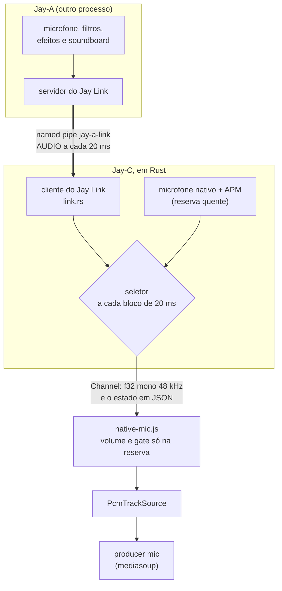
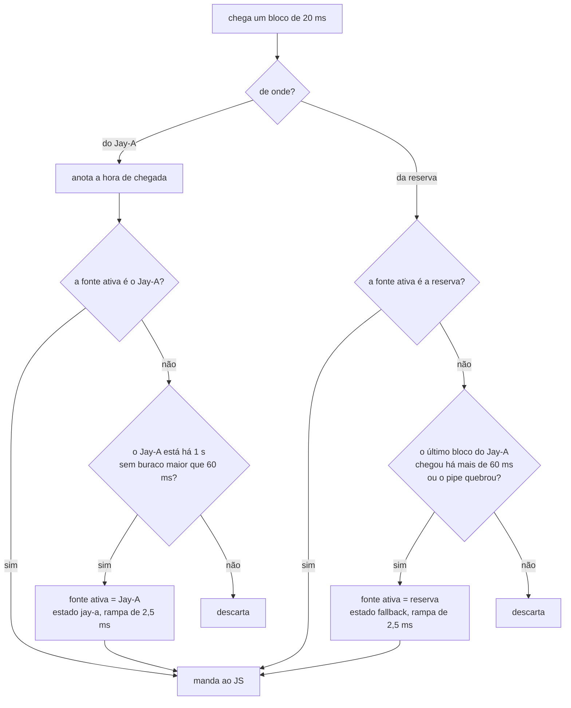
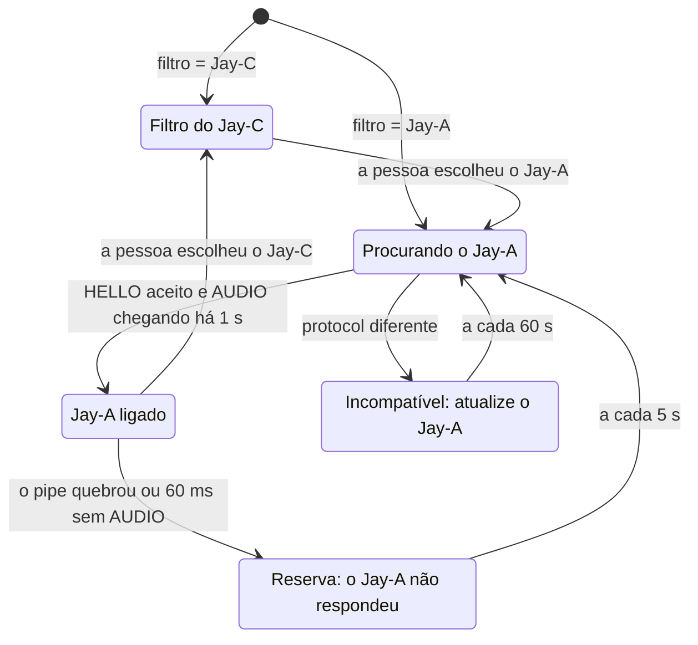
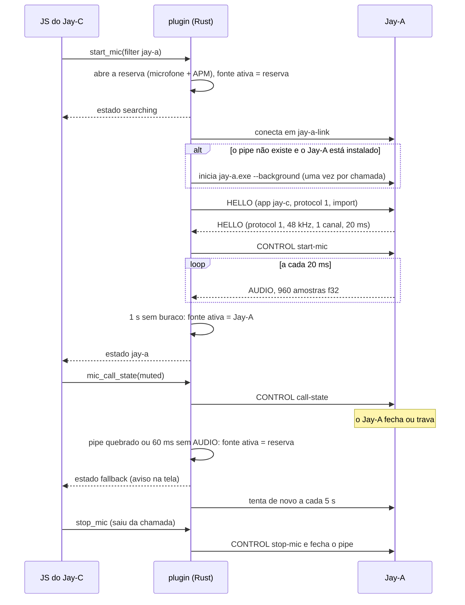

# Jay-C — Integração com o Jay-A

Este documento explica como o Jay-C usa o **Jay-A**, o app de áudio da linha Jay, para filtrar o microfone na chamada. A ideia é a mesma do Discord com o Krisp: a pessoa escolhe qual filtro usar. Se o Jay-A cair, a chamada continua com o filtro do Jay-C.

O Jay-A é planejado e escrito em outro repositório. O `docs/ARQUITETURA.md` de lá define o **Jay Link**: o pipe, as mensagens, os filtros, o soundboard, o editor e a conversão. Aqui ficam só o lado do Jay-C e o que o Jay-C precisa do contrato (seção 8).

Escrito em 2026-11-06, a partir do Jay-C 0.4.0. Nada foi implementado ainda.

## 1. O que a pessoa vê

- **Settings › Áudio › Filtro do microfone:** `Jay-A` ou `Jay-C`.
- **Com o Jay-A:** os filtros, o soundboard e os efeitos de voz são ajustados no Jay-A, pelo botão **Abrir Jay-A**. O Jay-C mostra o estado: "Jay-A ligado", "Procurando o Jay-A…" ou "O Jay-A não respondeu. Usando o filtro do Jay-C".
- **Se o Jay-A fechar ou travar** no meio da chamada, os outros continuam ouvindo a pessoa, agora pelo filtro do Jay-C, e aparece um aviso. Quando o Jay-A volta, o Jay-C volta para ele sozinho.
- **Sem o Jay-A instalado,** a opção aparece como "Jay-A (não instalado)", com o link da página de releases.
- **No Android,** nada muda: o Jay-A é só para Windows.

## 2. Visão geral

- O Jay-C envia **uma faixa só** ao servidor, e ela nunca muda: o seletor troca a fonte dentro do Rust. Não há `replaceTrack`, nova negociação ou mudança no servidor.
- O JS recebe o áudio no mesmo formato do `start_mic` de hoje, venha ele do Jay-A ou da reserva.

## 3. Reserva quente

No plano do Jay-A (seção 6, "Estados no Jay-C"), o Jay-C só abre o próprio microfone depois que o link cai. A troca é feita com `replaceTrack`, com a meta de um corte menor que 200 ms.

Este plano propõe outra forma: **com o Jay-A escolhido, o Jay-C mantém o próprio microfone e o APM rodando em paralelo**, e só descarta a saída deles enquanto o Jay-A funciona.

| | Reserva fria (plano do Jay-A) | Reserva quente (proposta) |
|---|---|---|
| Corte quando o Jay-A fecha | abrir WASAPI e APM, e depois `replaceTrack` (meta < 200 ms) | o pipe quebra quando o processo morre, e o bloco seguinte já vem da reserva (o T3 confirma) |
| Quando o Jay-A trava | só notado pelo `PING` (10 s) ou por um timer novo | 60 ms sem `AUDIO` |
| Eco logo depois da troca | o AEC3 recomeça do zero; o tempo até convergir não foi medido, e quem usa alto-falante ouve eco nesse intervalo | o AEC3 da reserva já convergiu |
| Código no JS | trocar a faixa e manter o mudo à mão | nenhum: a faixa é a mesma |
| Custo | nada enquanto o Jay-A funciona | uma captura WASAPI e um APM a mais (medir na I2) |

A reserva quente também permite medir o atraso do Jay-A sem equipamento: as duas fontes captam o mesmo microfone, então a correlação cruzada entre elas dá o atraso extra do link (seção 9).

**O que acontece com cada bloco de 20 ms:**

- **Quem vigia é a reserva:** o bloco dela chega a cada 20 ms, então ela percebe o travamento do Jay-A sem precisar de um timer próprio.
- **Por que 60 ms:** são 3 blocos, parecido com os ~60 ms que o worklet acumula antes de tocar (`pcm-player.worklet.js`). Na I2, medir se o outro lado ouve algum estalo nessa espera.
- **Por que 1 s para voltar:** um Jay-A que trava e solta não deve fazer a fonte ficar pulando de um lado para o outro.
- **A rampa:** o primeiro bloco depois de uma troca entra com um fade-in de 120 amostras, para não estalar na emenda. Mesmo assim, o timbre muda na troca, e isso não tem como evitar.
- **Com o Jay-A ativo, a reserva segue o microfone dele** (pelo `deviceId` do pedido P4). O microfone escolhido no Jay-C vale no modo Jay-C e enquanto o Jay-A ainda não conectou. Reabrir a reserva (por exemplo, quando o `micNeedsRestart` detecta outro microfone) não derruba o link.

## 4. Estados do link no Jay-C

- Em todos os estados, exceto **Jay-A ligado**, o som que sai é o da reserva.
- **Iniciar o Jay-A:** se o pipe não existe e o Jay-A está instalado (P5), o Jay-C o inicia com `--background`, **uma vez por chamada**. Um Jay-A que cai sempre ao abrir não é relançado em loop; nesse caso, o Jay-C só continua tentando conectar.

## 5. Uma chamada com o Jay-A

## 6. Interface no Jay-C

| Onde | O que muda |
|---|---|
| Settings › Áudio | Entra o **Filtro do microfone**: Jay-A ou Jay-C (`micFilter`, padrão `jay-c`). Com o Jay-A, aparecem o estado, a versão do Jay-A e o botão **Abrir Jay-A** (`CONTROL show`). Os ajustes do Jay-C (volume, sensibilidade, eco, ruído e ganho) continuam abaixo, sob o título "Reserva: quando o Jay-A não responde", porque são eles que valem na reserva. |
| Menu do microfone na chamada | A mesma escolha, para trocar de filtro sem sair da chamada. |
| Avisos | "O Jay-A parou. Usando o filtro do Jay-C." e "Jay-A de volta." pelo evento `notice` que já existe. "Atualize o Jay-A." quando o protocolo não bate. |
| Medidor e anel de fala | Continuam funcionando, porque o nível é medido em cada bloco. Com o Jay-A ativo, o JS não aplica volume nem gate (o Jay-A já aplicou), e o gate conta como aberto quando o bloco não é silêncio. |
| Settings › Solução de problemas | Uma linha para o Jay-A: o estado, a versão, as trocas para a reserva na chamada e o maior buraco entre blocos. |

## 7. Mudanças no Jay-C

| Arquivo | Mudança |
|---|---|
| `plugins/tauri-plugin-system-audio/src/link.rs` (novo) | Cliente do Jay Link. Abre o pipe e fala em quadros de opcode + tamanho (o mesmo formato do `src-tauri/src/discord.rs`): `HELLO`, `CONTROL`, `AUDIO`, `PING`/`PONG`. Uma thread de leitura entrega os blocos ao seletor. Não usa dependência nova. |
| `.../src/selector.rs` (novo) | O seletor da seção 3, como uma struct sem WASAPI: recebe os blocos e a hora. Assim, os testes rodam com tempos falsos. |
| `.../src/win.rs` | O `Mic` ganha o modo Jay-A, que junta a reserva (o `run_mic` de hoje), o link e o seletor. |
| `.../src/lib.rs`, `guest-js/index.js` | `MicOptions.filter` (`"jay-c"` ou `"jay-a"`). Os estados vão em JSON pelo mesmo Channel: `{ "link": "searching" \| "jay-a" \| "fallback" \| "incompatible", "version"? }`. Comandos novos: `mic_call_state({ inCall, muted })`, `jay_a_show()` e `jay_a_installed()`. |
| `frontend/src/core/native-mic.js` | Repassa os estados. Aplica o `shapeMic` só aos blocos da reserva e mede o nível de todos. |
| `frontend/src/core/call.js` | `micFilter` entra junto com as outras opções do microfone. Ganha o evento `jay-a-status`, os avisos, e passa a mandar o mudo ao plugin. |
| `store/settings.js`, `ui/audio-settings.js`, `ui/settings-modal.js`, `ui/audio-menu.js`, locales | A escolha do filtro, o estado e os textos, em PT e EN. |
| `docs/ARQUITETURA.md` e `.en.md` | O seletor no pipeline de áudio e a linha do Jay-A nas etapas. |

O servidor e a sinalização não mudam.

**Segurança no lado do Jay-C:** a segurança do pipe (DACL, `FILE_FLAG_FIRST_PIPE_INSTANCE`) é do Jay-A. O Jay-C aplica as mesmas regras na leitura:
- fecham o link e ativam a reserva: mensagem de controle acima de 64 KB, `AUDIO` com tamanho diferente de 3 840 bytes, JSON inválido e opcode desconhecido;
- amostras NaN ou infinitas viram 0.

O Jay-C não confere qual executável é o servidor, pelo mesmo motivo do Jay-A: um programa malicioso do mesmo usuário já pode abrir o microfone sozinho.

## 8. O que o Jay-C pede ao Jay-A

Pedidos feitos ao `ARQUITETURA.md` do Jay-A. O Jay-A aceitou os pedidos P1–P6, que já estão no documento dele (commit `0f51ea8` do repositório Jay-A). O P7 foi retirado.

| # | Pedido | Por quê |
|---|---|---|
| P1 | **D1 = (b):** o Jay-C mantém o filtro próprio para sempre, como reserva e como opção. Saem a "limpeza do Jay-C" da etapa 9 e a última linha da seção 10. | Pedido do usuário: "fallback caso caia e opção para escolher entre o Jay-A ou o Jay-C nativo". |
| P2 | Com o microfone ligado, mandar `AUDIO` **sempre a cada 20 ms**, inclusive em silêncio (zeros com o gate fechado). | Para o Jay-C, 60 ms sem `AUDIO` significa travamento. O `PING` de 10 s é lento demais para áudio. |
| P3 | Abrir o microfone no modo **compartilhado** do WASAPI, nunca no exclusivo. | A reserva quente do Jay-C abre o mesmo microfone ao mesmo tempo. |
| P4 | `CONTROL state` com o id do endpoint do microfone (`deviceId`, o mesmo id que o `list_mics` do Jay-C usa), além do nome. | Para a reserva usar o mesmo microfone que o Jay-A. |
| P5 | Instalação por usuário em `%LOCALAPPDATA%\Jay-A\jay-a.exe` (NSIS `currentUser`, como o Jay-C) e o argumento `--background`, que abre só na bandeja, sem janela. | É onde o Jay-C procura o Jay-A, tanto para mostrar "não instalado" quanto para iniciá-lo. |
| P6 | Os "Estados no Jay-C" da seção 6 do Jay-A passam a ser os da seção 4 deste documento. Na seção 10, `start_link_mic`/`stop_link_mic` viram `start_mic({ filter: "jay-a" })`. | É a reserva quente, que não troca de faixa. |
| P7 | Retirado. O pedido dizia que o `MAX_QUEUED_CHUNKS` não existia no Jay-C, mas ele existe: `plugins/tauri-plugin-system-audio/src/win.rs`, 5 blocos. É a fila das capturas por loopback, que volta a 40 ms quando passa do limite. O Jay-A usa essa fila como modelo para a fila do link. No caminho até o WebRTC, quem limita é o `pcm-player.worklet.js`. | O erro foi do Jay-C. |

## 9. Testes e medições

Enquanto o Jay-A não está pronto, o lado do Jay-C é testado com um **Jay-A falso**:

- **`cargo run --example fake_jay_a`** (no plugin): um servidor do Jay Link que responde ao `HELLO` e manda um tom de 440 Hz em blocos de 20 ms. Opções: `--stall-after <s>`, `--exit-after <s>`, `--protocol <n>` e `--jitter <ms>`.
- **`cargo run --example jay_a_probe`:** só o cliente do Jay-C, para o chat do Jay-A testar o servidor dele. Ele conecta, faz o `HELLO` e pede o microfone por 30 s. Mostra os intervalos entre blocos (p50, p99 e máximo) e os buracos, e passa se não houver buraco maior que 60 ms.

| Teste (`cargo test`) | Prova |
|---|---|
| T1 | ligado, a saída é o tom do falso, não a reserva |
| T2 | quando o falso trava, a saída passa para a reserva em ≤ 80 ms, com uma troca só e sem buraco maior que 20 ms entre blocos |
| T3 | quando o falso fecha, a troca vem no bloco seguinte |
| T4 | quando o falso volta, a saída volta para ele depois de ~1 s |
| T5 | com protocolo diferente, a saída fica na reserva, com o estado `incompatible` |
| T6 | com jitter de ±15 ms, nenhuma troca |

O seletor (T1, T2, T4 e T6) é testado com tempos falsos. Já o `link.rs` (T3, T5) é testado contra o falso de verdade, por um pipe.

**Testes no app:**
- **Com o falso (I2):** um bot numa página separada (como no CLAUDE.md) ouve a chamada enquanto o falso manda o tom. Ao matar o falso, o bot passa a ouvir o microfone. O maior buraco é medido no `inbound-rtp` do bot. A CPU da reserva também é medida, e confirma-se que os outros apps continuam sem abafar com dois microfones abertos (spike 09).
- **Com o Jay-A de verdade (I5):** a correlação cruzada entre os blocos do Jay-A e os da reserva dá o atraso médio do link, e os intervalos entre blocos dão o jitter. É o S1 do Jay-A, que tem a meta de ≤ 5 ms no p99 sobre o microfone nativo. O eco é medido com o teste de eco do Jay-C (S2 do Jay-A).
- **Verificar também:** se o Channel mantém a ordem entre o estado em JSON e os blocos em bytes. Se não mantiver, um bloco na troca leva volume e gate a mais ou a menos; aí é melhor marcar a fonte em cada bloco.

## 10. Etapas

Cada etapa termina com algo testável.

| # | Etapa | Pronto quando | Depende do Jay-A |
|---|---|---|---|
| I0 ✅ | Este plano e os pedidos ao Jay-A | os dois documentos descrevem o mesmo Jay Link: P1–P6 aceitos (`0f51ea8` do Jay-A), P7 retirado | — |
| I1 | `link.rs`, seletor, Jay-A falso e `jay_a_probe` | T1–T6 passam | não |
| I2 | Modo Jay-A no `Mic` (reserva quente) e estados até o JS | no app, com o falso, o bot ouve o tom; ao matar o falso, ele passa a ouvir o microfone; o maior buraco e a CPU da reserva estão medidos | não |
| I3 | Interface (seção 6) | trocar entre Jay-A e Jay-C durante a chamada funciona; `npm test` e a auditoria de contraste passam | não |
| I4 | Achar e iniciar o Jay-A (P5) | com um `jay-a.exe` falso no caminho, entrar na chamada o inicia uma vez e liga em até 3 s | P5 |
| I5 | Com o Jay-A de verdade (etapa 3 dele) | atraso e jitter medidos; o eco removido como hoje; fechar o Jay-A no meio da chamada não corta a voz para o bot | etapa 3 |
| I6 | Soundboard na barra da chamada (etapa 8 dele) | o botão lista os clipes, e um clique toca para o bot | etapa 8 |
| I7 | Release do Jay-C com a integração | o instalador funciona com e sem o Jay-A instalado | etapa 9 |

## 11. Fora da integração

- **Editor, conversão de formatos e biblioteca do soundboard** ficam só no Jay-A. O Jay-C não lê nem converte arquivos de áudio.
- **Soundboard numa faixa própria no SFU** (D2 (b) do Jay-A) fica para depois. Por enquanto, mutar no Jay-C silencia tudo.
- **Android e outros sistemas:** sem Jay-A e sem mudança.
- **Servidor e sinalização:** sem mudança.
- **Ícone:** o Jay-A usa o lobo do Jay-C por enquanto (decisão do Jay-A), e o Jay-C não precisa de imagem nova.
