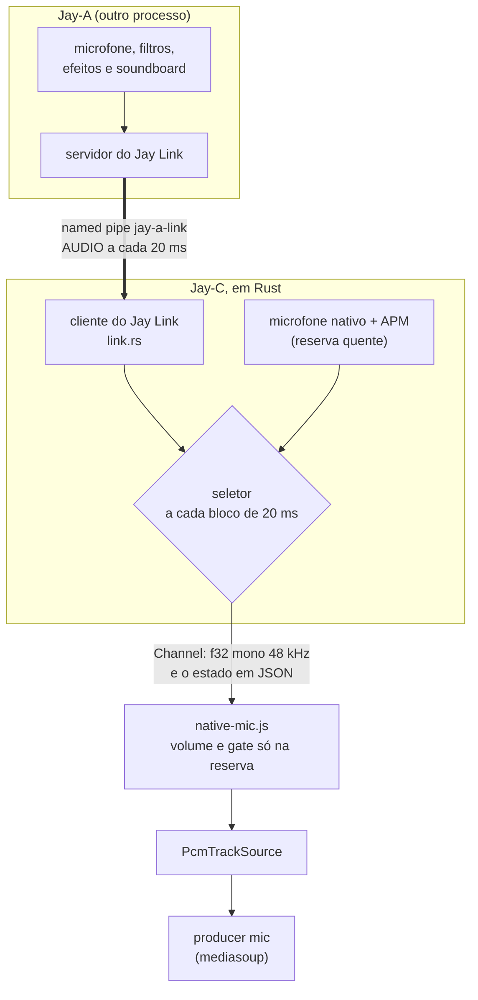
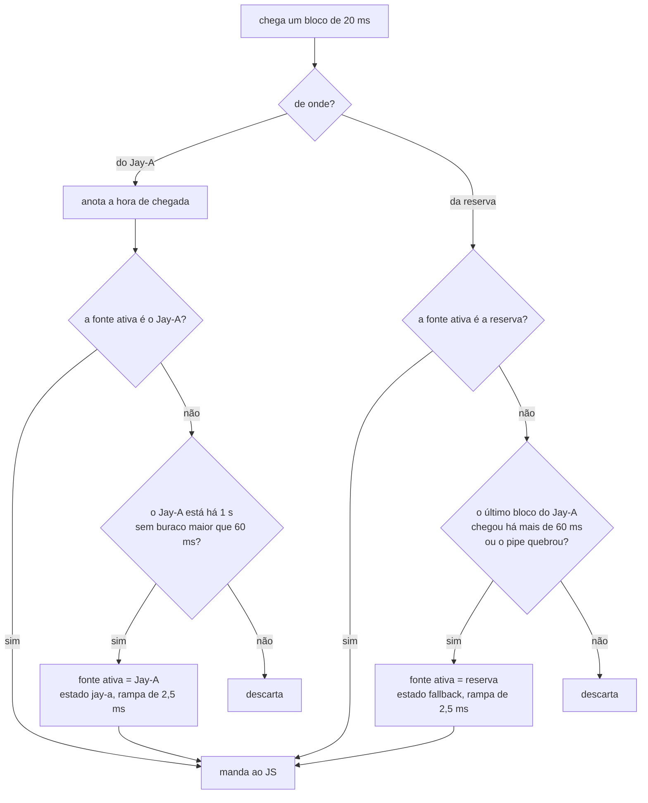
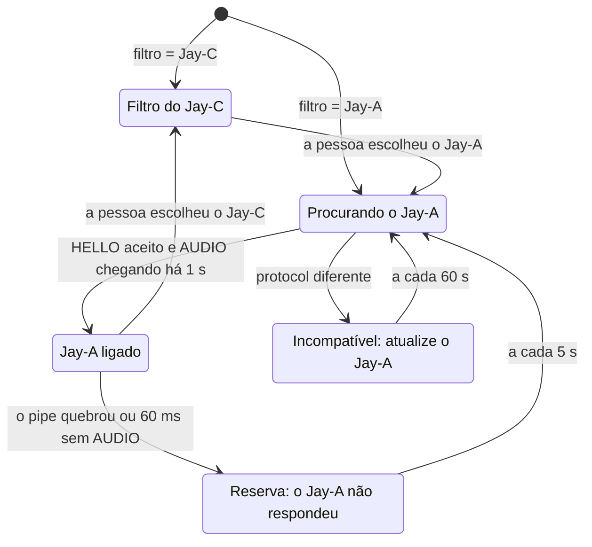
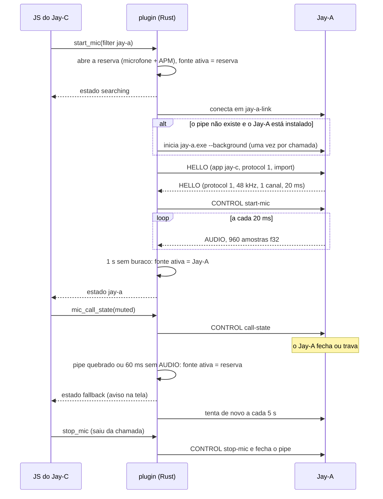

# Jay-C — Integração com o Jay-A

Este documento explica como o Jay-C usa o **Jay-A**, o app de áudio da linha Jay, para filtrar o microfone na chamada. A ideia é a mesma do Discord com o Krisp: a pessoa escolhe qual filtro usar. Se o Jay-A cair, a chamada continua com o filtro do Jay-C.

O Jay-A é planejado e escrito em outro repositório. O `docs/ARQUITETURA.md` de lá define o **Jay Link**: o pipe, as mensagens, os filtros, o soundboard, o editor e a conversão. Aqui ficam só o lado do Jay-C e o que o Jay-C precisa do contrato (seção 8).

Escrito em 2026-11-06, a partir do Jay-C 0.4.0. Nada foi implementado ainda.

## 1. O que a pessoa vê

- **Settings › Áudio › Filtro do microfone:** `Jay-A` ou `Jay-C`.
- **Com o Jay-A:** os filtros, o soundboard e os efeitos de voz são ajustados no Jay-A, pelo botão **Abrir Jay-A**. O Jay-C mostra o estado: "Jay-A ligado", "Procurando o Jay-A…" ou "O Jay-A não respondeu. Usando o filtro do Jay-C".
- **Se o Jay-A fechar ou travar** no meio da chamada, os outros continuam ouvindo a pessoa, agora pelo filtro do Jay-C, e aparece um aviso. Quando o Jay-A volta, o Jay-C volta para ele sozinho.
- **Sem o Jay-A instalado,** a opção aparece como "Jay-A (não instalado)", e o botão **Baixar o Jay-A** abre a página de releases do Jay-A no navegador.
- **No Android,** nada muda: o Jay-A é só para Windows.

## 2. Visão geral

- O Jay-C envia **uma faixa só** ao servidor, e ela nunca muda: o seletor troca a fonte dentro do Rust. Não há `replaceTrack`, nova negociação ou mudança no servidor.
- O JS recebe o áudio no mesmo formato do `start_mic` de hoje, venha ele do Jay-A ou da reserva.

## 3. Reserva quente

No plano do Jay-A (seção 6, "Estados no Jay-C"), o Jay-C só abre o próprio microfone depois que o link cai. A troca é feita com `replaceTrack`, com a meta de um corte menor que 200 ms.

Este plano propõe outra forma: **com o Jay-A escolhido, o Jay-C mantém o próprio microfone e o APM rodando em paralelo**, e só descarta a saída deles enquanto o Jay-A funciona.

| | Reserva fria (plano do Jay-A) | Reserva quente (proposta) |
|---|---|---|
| Corte quando o Jay-A fecha | abrir WASAPI e APM, e depois `replaceTrack` (meta < 200 ms) | o pipe quebra quando o processo morre, e o bloco seguinte já vem da reserva (o T3 confirma) |
| Quando o Jay-A trava | só notado pelo `PING` (10 s) ou por um timer novo | 60 ms sem `AUDIO` |
| Eco logo depois da troca | o AEC3 recomeça do zero; o tempo até convergir não foi medido, e quem usa alto-falante ouve eco nesse intervalo | o AEC3 da reserva já convergiu |
| Código no JS | trocar a faixa e manter o mudo à mão | nenhum: a faixa é a mesma |
| Custo | nada enquanto o Jay-A funciona | uma captura WASAPI e um APM a mais (medir na I2) |

A reserva quente também permite medir o atraso do Jay-A sem equipamento: as duas fontes captam o mesmo microfone, então a correlação cruzada entre elas dá o atraso extra do link (seção 9).

**O que acontece com cada bloco de 20 ms:**

- **Quem vigia é a reserva:** o bloco dela chega a cada 20 ms, então ela percebe o travamento do Jay-A sem precisar de um timer próprio.
- **Nada se perde na espera:** enquanto o Jay-A toca, a reserva guarda os seus últimos 4 blocos. Na troca, ela manda de uma vez os que chegaram depois do último bloco do Jay-A, junto com o atual. O alinhamento fino entre as duas fontes depende do atraso do Jay-A, que vai ser medido na I5. O Jay-A promete no máximo 5 ms de atraso na cadeia de filtros (até 40 ms com a supressão forte, etapa 7 dele).
- **Por que 60 ms:** são 3 blocos, parecido com os ~60 ms que o worklet acumula antes de tocar (`pcm-player.worklet.js`). Medido na I2: o worklet não chega a secar na troca (seção 9).
- **Por que 1 s para voltar:** um Jay-A que trava e solta não deve fazer a fonte ficar pulando de um lado para o outro.
- **A rampa:** o primeiro bloco depois de uma troca entra com um fade-in de 120 amostras, para não estalar na emenda. Mesmo assim, o timbre muda na troca, e isso não tem como evitar.
- **Com o Jay-A ativo, a reserva segue o microfone dele** (pelo `deviceId` do pedido P4). O microfone escolhido no Jay-C vale no modo Jay-C e enquanto o Jay-A ainda não conectou. Reabrir a reserva (por exemplo, quando o `micNeedsRestart` detecta outro microfone) não derruba o link. Isso vale desde a I3. Ao reabrir, o plugin passa o link e o seletor do microfone antigo para o novo (`JayAStart::Keep` + `rewire`), e só a captura e o canal trocam.

## 4. Estados do link no Jay-C

- Em todos os estados, exceto **Jay-A ligado**, o som que sai é o da reserva.
- **Iniciar o Jay-A:** se o pipe não existe e o Jay-A está instalado (P5, `%LOCALAPPDATA%\Jay-A\jay-a.exe`), o Jay-C o inicia com `--background`, **uma vez por chamada**, e tenta conectar a cada 200 ms durante 3 s. Depois disso, volta à tentativa de 5 em 5 s.
  - Um Jay-A que cai sempre ao abrir não é relançado em loop; nesse caso, o Jay-C só continua tentando conectar.
  - "Uma vez por chamada" vale enquanto existir o mesmo `JayA`: reabrir o microfone o mantém. Trocar o filtro para Jay-C e voltar, ou abrir o **Testar microfone** fora da chamada, cria outro.
  - **Para testar sem instalar nada:** nas builds de debug, a variável `JAYC_JAY_A_EXE` aponta para outro executável (por exemplo, o `fake_jay_a.exe`), antes do `%LOCALAPPDATA%`.
  - **Pendente para a I6 (soundboard):** o Jay-A iniciado pelo Jay-C é filho do `jay-c.exe`. Para a live "tela inteira menos o Jay-C", um processo filho pode contar como "o próprio Jay-C", e um Jay-A aberto pelo usuário não conta. Os sons do Jay-A nos fones (o monitor do soundboard, o "ouvir meu microfone") dobrariam na live. Decidir se o `jay-a.exe` sai sempre do som da live.

## 5. Uma chamada com o Jay-A

## 6. Interface no Jay-C

| Onde | O que muda |
|---|---|
| Settings › Áudio | Entra o **Filtro do microfone**, antes dos dispositivos: Jay-C ou Jay-A (`micFilter`, padrão `jay-c`), num seletor de dois botões, com uma frase sobre cada um. Com o Jay-A aparecem: • o estado: "Procurando o Jay-A…", "Jay-A ligado (versão)", "não está respondendo" ou "Atualize o Jay-A"; • o botão **Abrir Jay-A** (`CONTROL show`), ativo só com o Jay-A conectado; • a frase de que os ajustes abaixo (volume, sensibilidade, eco, ruído e ganho) só valem enquanto o Jay-A não responde. Fora da chamada, o **Testar microfone** também conecta ao Jay-A. |
| Na chamada | Não existe um menu do microfone na chamada. As Configurações abrem durante a chamada, e a troca de filtro vale na hora, sem sair dela. |
| Avisos | Pelo evento `notice` que já existe: "O Jay-A parou. Usando o filtro do Jay-C." só se a queda durar **2 s**, e "O Jay-A voltou." só depois de um "parou". Uma travada breve fica coberta pela reserva, sem aviso (seção 9). "Atualize o Jay-A" aparece quando o protocolo não bate. |
| Medidor e anel de fala | Continuam funcionando, porque o nível é medido em cada bloco. Com o Jay-A ativo, o JS não aplica volume nem gate (o Jay-A já aplicou), e o gate conta como aberto quando o bloco não é silêncio. |
| Settings › Solução de problemas | O diagnóstico copiado ganha `me.jayA`: o estado do link, a versão, o microfone do Jay-A e `fallbacks` (quantas vezes a reserva assumiu na chamada, inclusive as breves). O maior buraco entre blocos ficou de fora, porque a medição do caminho worklet → faixa é de outra sessão. |

## 7. Mudanças no Jay-C

| Arquivo | Mudança |
|---|---|
| `plugins/tauri-plugin-system-audio/src/link.rs` (novo) | Cliente do Jay Link. Abre o pipe e fala em quadros de opcode + tamanho (o mesmo formato do `src-tauri/src/discord.rs`): `HELLO`, `CONTROL`, `AUDIO`, `PING`/`PONG`. Uma thread de leitura entrega os blocos ao seletor. Não usa dependência nova. |
| `.../src/selector.rs` (novo) | O seletor da seção 3, como uma struct sem WASAPI: recebe os blocos e a hora. Assim, os testes rodam com tempos falsos. |
| `.../src/link/fake.rs`, `examples/fake_jay_a.rs`, `examples/jay_a_probe.rs` (novos) | O Jay-A falso, que só entra nos testes e com `--features fake-jay-a`, e o probe (seção 9). |
| `.../src/jay_a.rs` (novo) | O modo Jay-A. Um gerenciador conecta e reconecta: na hora depois de uma queda, a cada 5 s enquanto o Jay-A não está lá e a cada 60 s se ele é incompatível. Ele manda `start-mic` e o último `call-state` a cada conexão. A saída é uma só: o seletor escolhe a fonte de cada bloco, e o estado vai antes dos blocos a que se refere. |
| `.../src/win.rs` | O `Mic` ganha o modo Jay-A: a captura de hoje vira a reserva e entrega os blocos ao `jay_a.rs`. |
| `.../src/lib.rs`, `guest-js/index.js` | `MicOptions.filter` (`"jay-c"` ou `"jay-a"`). Os estados vão em JSON pelo mesmo Channel: `{ "link": "searching" \| "jay-a" \| "fallback" \| "incompatible", "version"? }`. Comandos novos: `mic_call_state({ inCall, muted })` (I2), `jay_a_show()` (I3), `jay_a_installed()` e `jay_a_open_releases()` (I4). O último abre só a página de releases do Jay-A, um endereço fixo, pelo `explorer.exe`: o app não tem outro jeito de abrir links. Ao reabrir no modo Jay-A, `start_mic` mantém o link do microfone anterior. |
| `frontend/src/core/native-mic.js` | Repassa os estados. Aplica o `shapeMic` só aos blocos da reserva e mede o nível de todos. Também tem `jayANotices`, os avisos sem as travadas breves. |
| `frontend/src/core/call.js` | `micFilter` entra junto com as outras opções do microfone, e `setMicFilter` reabre o microfone. Ganha `jayAStatus`, `jayAFallbacks` e o evento `jay-a-status`, manda o mudo ao plugin e dá os avisos. No modo Jay-A, abre a reserva no microfone do Jay-A (`deviceId`), também no `micNeedsRestart`. |
| `store/settings.js`, `ui/audio-settings.js`, `ui/settings-modal.js`, `core/diagnostics.js`, locales | A escolha do filtro, o estado, o botão, o diagnóstico e os textos, em PT e EN. |
| `docs/ARQUITETURA.md` e `.en.md` | O seletor no pipeline de áudio e a linha do Jay-A nas etapas. |

O servidor e a sinalização não mudam.

**Segurança no lado do Jay-C:** a segurança do pipe (DACL, `FILE_FLAG_FIRST_PIPE_INSTANCE`) é do Jay-A. O Jay-C aplica as mesmas regras na leitura:
- fecham o link e ativam a reserva: mensagem de controle acima de 64 KB, `AUDIO` com tamanho diferente de 3 840 bytes, JSON inválido e opcode desconhecido;
- amostras NaN ou infinitas viram 0.

Antes do `HELLO`, o Jay-C confere que o servidor do pipe roda **no mesmo usuário do Windows** (`GetNamedPipeServerProcessId` e o SID do token do processo). Se não conseguir confirmar, recusa. O motivo: o nome do pipe vale para o PC inteiro, então outro usuário logado poderia criá-lo antes do Jay-A e pôr áudio na chamada.

O pipe também é aberto com `SECURITY_IDENTIFICATION`, para que o dono dele possa identificar o Jay-C, mas não agir como ele.

O Jay-C não confere qual executável é o servidor, pelo mesmo motivo do Jay-A: um programa malicioso do mesmo usuário já pode abrir o microfone sozinho.

## 8. O que o Jay-C pede ao Jay-A

Pedidos feitos ao `ARQUITETURA.md` do Jay-A. O Jay-A aceitou os pedidos P1–P6, que já estão no documento dele (commit `0f51ea8` do repositório Jay-A). O P7 foi retirado.

| # | Pedido | Por quê |
|---|---|---|
| P1 | **D1 = (b):** o Jay-C mantém o filtro próprio para sempre, como reserva e como opção. Saem a "limpeza do Jay-C" da etapa 9 e a última linha da seção 10. | Pedido do usuário: "fallback caso caia e opção para escolher entre o Jay-A ou o Jay-C nativo". |
| P2 | Com o microfone ligado, mandar `AUDIO` **sempre a cada 20 ms**, inclusive em silêncio (zeros com o gate fechado). | Para o Jay-C, 60 ms sem `AUDIO` significa travamento. O `PING` de 10 s é lento demais para áudio. |
| P3 | Abrir o microfone no modo **compartilhado** do WASAPI, nunca no exclusivo. | A reserva quente do Jay-C abre o mesmo microfone ao mesmo tempo. |
| P4 | `CONTROL state` com o id do endpoint do microfone (`deviceId`, o mesmo id que o `list_mics` do Jay-C usa), além do nome. | Para a reserva usar o mesmo microfone que o Jay-A. |
| P5 | Instalação por usuário em `%LOCALAPPDATA%\Jay-A\jay-a.exe` (NSIS `currentUser`, como o Jay-C) e o argumento `--background`, que abre só na bandeja, sem janela. | É onde o Jay-C procura o Jay-A, tanto para mostrar "não instalado" quanto para iniciá-lo. |
| P6 | Os "Estados no Jay-C" da seção 6 do Jay-A passam a ser os da seção 4 deste documento. Na seção 10, `start_link_mic`/`stop_link_mic` viram `start_mic({ filter: "jay-a" })`. | É a reserva quente, que não troca de faixa. |
| P7 | Retirado. O pedido dizia que o `MAX_QUEUED_CHUNKS` não existia no Jay-C, mas ele existe: `plugins/tauri-plugin-system-audio/src/win.rs`, 5 blocos. É a fila das capturas por loopback, que volta a 40 ms quando passa do limite. O Jay-A usa essa fila como modelo para a fila do link. No caminho até o WebRTC, quem limita é o `pcm-player.worklet.js`. | O erro foi do Jay-C. |

## 9. Testes e medições

Enquanto o Jay-A não está pronto, o lado do Jay-C é testado com um **Jay-A falso**:

- **`cargo run --example fake_jay_a --features fake-jay-a`** (no plugin): um servidor do Jay Link que responde ao `HELLO` e manda um tom de 440 Hz em blocos de 20 ms. Opções: `--pipe <nome>`, `--stall-after <s>`, `--stall-for <s>`, `--exit-after <s>`, `--protocol <n>`, `--jitter <ms>` e `--device-id <id>` (o microfone que ele diz usar, para ver a reserva segui-lo). Com `--pipe`, o app de dev procura o mesmo nome se tiver `JAYC_JAY_A_PIPE=<nome>` no ambiente (só nas builds de debug, como a `JAYC_JAY_A_EXE`). Assim, um teste não cruza com outro que está no pipe de verdade.
- **`cargo run --example jay_a_probe`:** só o cliente do Jay-C, para o chat do Jay-A testar o servidor dele. Ele conecta, faz o `HELLO` e pede o microfone por 30 s. Mostra os intervalos entre blocos (p50, p99 e máximo) e os buracos, e passa se não houver buraco maior que 60 ms.

| Teste (`cargo test`) | Prova |
|---|---|
| T1 | ligado, a saída é o tom do falso, não a reserva |
| T2 | quando o falso trava, a saída passa para a reserva em ≤ 80 ms (70 ms no teste), com uma troca só, e os blocos da reserva capturados na espera saem junto, sem perder áudio. Se o pipe fecha, a troca vem no bloco seguinte da reserva. |
| T3 | quando o falso fecha, o link percebe na hora, antes do bloco seguinte (medido: < 1 ms depois do último bloco) |
| T4 | quando o falso volta, a saída volta para ele depois de ~1 s, mesmo que ele reconecte 15 ms depois de fechar |
| T5 | com protocolo diferente, a saída fica na reserva, com o estado `incompatible` |
| T6 | com jitter de ±15 ms, nenhuma troca |

O seletor (T1, T2, T4 e T6) é testado com tempos falsos. Já o `link.rs` (T3, T5) é testado contra o falso de verdade, por um pipe. Os testes do link também cobrem:
- os quadros cortados em qualquer ponto;
- o que o Jay-C recusa: `AUDIO` de outro tamanho, opcode desconhecido, JSON inválido e mensagem acima de 64 KB, recusada só pelo cabeçalho;
- NaN virando 0;
- "Jay-A não está rodando";
- o tom e o `state` do falso chegando.

Três regras do seletor foram quebradas de propósito, e os testes pegaram as três:
- reconexão sem esperar 1 s;
- troca sem os blocos da espera;
- o dobro do tempo para notar o travamento.

**Medido na I1** (o probe contra o falso, build de debug):

| Modo do falso | Blocos | Intervalo p50 / p99 / máximo | Resultado |
|---|---|---|---|
| estável, 30 s | 1 497 (~1 500) | 15,8 / 32,1 / 32,9 ms | PASS |
| jitter de 15 ms, 10 s | 499 (~500) | 15,8 / 47,6 / 49,0 ms | PASS |
| travamento de 200 ms, 6 s | 287 (~300) | máximo de 218 ms | FAIL, como devia |

- **Intervalos de ~15,6 e ~31 ms:** vêm do relógio de 15,6 ms do Windows nas esperas do falso, e a média dá 20 ms. O Jay-A de verdade vai seguir o relógio do microfone.
- **Mensagens de controle esperam até 50 ms** na fila do link, que olha a fila entre uma leitura e outra. Por isso o primeiro bloco chegou de 0,3 a 63 ms depois do `start-mic`.

**Testes no app:**
- **Com o falso (I2):** um bot numa página separada (como no CLAUDE.md) ouve a chamada enquanto o falso manda o tom. Ao matar o falso, o bot passa a ouvir o microfone.

**Medido na I2** (app de dev com perfil de teste, servidor na 3001, bot ensurdecido no painel do navegador, falso no pipe de verdade `jay-a-link`, build de debug):
- **Estados:** "searching" ao entrar. O falso foi aberto depois, e o app conectou na tentativa seguinte (de 5 em 5 s); 1 s depois, "jay-a".
- **O tom chega ao bot:** a −13,1 a −13,4 dBFS, o mesmo nível que sai do falso.
- **Matar o processo do falso:** o link percebeu, e 15 ms depois o bloco seguinte da reserva assumiu ("fallback"). O bot parou de ouvir o tom ~250 ms depois, o atraso normal da rede e do buffer, e passou a ouvir o microfone (o Voicemeeter Out B2, em silêncio).
- **Sem buraco na troca:** os blocos chegaram ao worklet com no máximo 34 ms de intervalo em volta da troca. Os blocos da espera saíram junto com o atual. Simulado sobre os horários de chegada, o buffer do worklet nunca secou.
- **Áudio contínuo vindo do Rust:** em 750 blocos (15 s) com o Jay-A ativo, nenhum salto entre amostras, nem dentro dos blocos nem nas emendas.
- **Mudo:** o falso recebeu `start-mic`, o `call-state` guardado e um `call-state` a cada troca de mudo.
- **CPU** (% de um núcleo, debug, 20 s com o Jay-A ativo):

  | Thread | CPU |
  |---|---|
  | reserva: microfone + APM | 1,8 % |
  | referência de eco | 1,0 % |
  | link | 1,1 % |
  | gerenciador | 0 % |

  A reserva custa o mesmo que o microfone do Jay-C no modo Jay-C, porque é a mesma captura.
- **Blocos "não puros" no gravador (resolvido em [spikes/11](spikes/11-continuidade-do-mic.md)):** o gravador dentro do app (ScriptProcessor) e o bot achavam alguns blocos curtos do tom que não eram tom puro: 4,6 % dos blocos de 10,7 ms no app. Medido depois em quatro pontos, com um detector exato: em regime, o caminho até a faixa é contínuo. Quem perdia ou repetia um quantum de 128 quadros era o próprio ScriptProcessor. O defeito real era outro: depois de cada parada da thread principal, a fila do worklet ficava em ~220 ms para sempre e cortava blocos sem transição. Corrigido no `pcm-player.worklet.js`.
- **Bug achado no Jay-A falso:** ele fechava depois do primeiro cliente, porque criava a instância nova do pipe com `FILE_FLAG_FIRST_PIPE_INSTANCE` antes de fechar a antiga. Corrigido e coberto por teste; o chat do Jay-A foi avisado, porque o servidor dele segue o mesmo modelo.
- **Com o Jay-A de verdade (I5):** a correlação cruzada entre os blocos do Jay-A e os da reserva dá o atraso médio do link, e os intervalos entre blocos dão o jitter. É o S1 do Jay-A, que tem a meta de ≤ 5 ms no p99 sobre o microfone nativo. O eco é medido com o teste de eco do Jay-C (S2 do Jay-A).
- **Verificar também:** se o Channel mantém a ordem entre o estado em JSON e os blocos em bytes. No Rust, o estado sai antes dos blocos (o teste do modo Jay-A pega a ordem invertida), mas a ordem na chegada ao JS não foi verificada: na I2, o volume era 1 e o gate estava desligado, e assim um bloco trocado não muda nada. Se não mantiver, um bloco na troca leva volume e gate a mais ou a menos; aí é melhor marcar a fonte em cada bloco.
- **Com o Jay-A de verdade (I5), também:** os outros apps continuam sem abafar com dois microfones abertos, o do Jay-A e a reserva (spike 09).

**Medido na I3** (app de dev com perfil de teste, Jay-A falso no pipe de verdade):
- **Settings › Áudio, fora da chamada:**
  - o seletor Jay-C / Jay-A troca a frase;
  - o **Testar microfone** mostrou "Procurando o Jay-A…" e depois "Jay-A ligado (fake)";
  - o **Abrir Jay-A** ficou ativo só com o Jay-A conectado, e o falso recebeu `{"type":"show"}`;
  - a auditoria de contraste não achou nada abaixo do mínimo (21 textos).
- **Reabrir o microfone na chamada** (trocar a supressão de ruído duas vezes): o estado foi só reenviado como "jay-a". Não houve nova busca, o falso não recebeu outro `start-mic` e não apareceu aviso.
- **A reserva segue o microfone do Jay-A:** o padrão do Windows era o "Microfone (2- ME6S)" e o falso anunciou o "Voicemeeter Out B1". A reserva abriu o B1, e o link continuou.
- **Trocar o filtro no meio da chamada:** para Jay-C, o estado zera, sem aviso. De volta a Jay-A, "searching" e depois "jay-a" em ~1 s.
- **Avisos:**
  - uma travada de 300 ms do falso (`--stall-after 4 --stall-for 0.3`) deu 1,25 s de reserva, contada em `fallbacks`, sem aviso;
  - com o falso morto, "O Jay-A parou" veio 2,0 s depois da queda, e "O Jay-A voltou" quando ele reconectou.
- **Travadas sob carga:** com dois builds de debug compilando, o seletor caiu para a reserva 10 vezes em ~5 min, por ~1 s cada, sem o link cair (nenhum `start-mic` novo no falso). É por isso que o aviso espera 2 s. Com o Jay-A de verdade, em release, a frequência dessas travadas fica para medir na I5.
- **Visto no PC durante os testes:** o microfone padrão do Windows mudou algumas vezes, com erros 0x88890004 (dispositivo invalidado). O app reabriu a reserva com "Microphone back" sem derrubar o link.

**Medido na I4** (app de dev com `JAYC_JAY_A_EXE` apontando para o Jay-A falso, que não estava rodando):
- **Settings › Áudio:** com o "Jay-A instalado", o botão diz "Jay-A". Com o executável renomeado por um instante, ele virou "Jay-A (não instalado)", e apareceu a linha "O Jay-A não está instalado neste PC." com **Baixar o Jay-A**. O contraste passou (22 textos). O botão não foi clicado no teste, porque abriria o navegador na tela do usuário.
- **Entrar na chamada no modo Jay-A** (relógio de parede):

  | Momento | Depois de entrar |
  |---|---|
  | o app abre o `fake_jay_a.exe --background`, como filho do `jay-c.exe` | 119 ms |
  | link conectado | 341 ms depois de abrir o falso |
  | o Jay-A assume | 1,24 s depois de abrir o falso |

  A meta era ligar em até 3 s.
- **Uma vez por chamada:** com o Jay-A morto no meio da chamada, o app ficou na reserva, com o aviso "O Jay-A parou", e em 12 s não abriu o Jay-A de novo.
- **Teste do plugin** (`starts_jay_a_once_and_links_within_3_s`): um Jay-A que leva 400 ms para abrir o pipe assume em ~1,65 s, e depois da queda não é aberto de novo. Sem a regra "uma vez", o teste falha: foram 4 aberturas.

## 10. Etapas

Cada etapa termina com algo testável.

| # | Etapa | Pronto quando | Depende do Jay-A |
|---|---|---|---|
| I0 ✅ | Este plano e os pedidos ao Jay-A | os dois documentos descrevem o mesmo Jay Link: P1–P6 aceitos (`0f51ea8` do Jay-A), P7 retirado | — |
| I1 ✅ | `link.rs`, seletor, Jay-A falso e `jay_a_probe` | T1–T6 passam (16 testes no plugin); o probe passa contra o falso estável e reprova o travamento | não |
| I2 ✅ | Modo Jay-A no `Mic` (reserva quente) e estados até o JS | no app, com o falso, o bot ouve o tom; ao matar o falso, ele passa a ouvir o microfone; o maior buraco e a CPU da reserva estão medidos (seção 9) | não |
| I3 ✅ | Interface (seção 6), avisos, `jay_a_show()` e a reserva seguindo o microfone do Jay-A sem derrubar o link | trocar entre Jay-A e Jay-C durante a chamada funciona; `npm test` e a auditoria de contraste passam (seção 9) | não |
| I4 ✅ | Achar e iniciar o Jay-A (P5) | com um `jay-a.exe` falso no caminho, entrar na chamada o inicia uma vez e liga em até 3 s (seção 9) | P5 |
| I5 | Com o Jay-A de verdade (etapa 3 dele) | atraso e jitter medidos; o eco removido como hoje; fechar o Jay-A no meio da chamada não corta a voz para o bot | etapa 3 |
| I6 | Soundboard na barra da chamada (etapa 8 dele) | o botão lista os clipes, e um clique toca para o bot | etapa 8 |
| I7 | Release do Jay-C com a integração | o instalador funciona com e sem o Jay-A instalado | etapa 9 |

## 11. Fora da integração

- **Editor, conversão de formatos e biblioteca do soundboard** ficam só no Jay-A. O Jay-C não lê nem converte arquivos de áudio.
- **Soundboard numa faixa própria no SFU** (D2 (b) do Jay-A) fica para depois. Por enquanto, mutar no Jay-C silencia tudo.
- **Android e outros sistemas:** sem Jay-A e sem mudança.
- **Servidor e sinalização:** sem mudança.
- **Ícone:** o Jay-A usa o lobo do Jay-C por enquanto (decisão do Jay-A), e o Jay-C não precisa de imagem nova.
